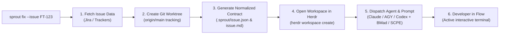

# 🌱 Sprout

[](LICENSE)
[](https://git-scm.com/docs/git-worktree)
[](https://herdr.dev)
[](docs/workflows.md#supported-agents)

> **One command from issue ticket to active coding agent in a focused Git worktree.**

Starting a task usually means a dozen repetitive, context-draining steps: find the ticket, name the branch, set up a worktree, open a terminal, launch an agent, paste in the ticket context. **Sprout** collapses all of that into one command:

```bash
sprout fix --issue FT-123
```

...and leaves you in an active terminal with the agent already briefed on the ticket, ready to pair.

---

## Quick Start

### Before you start

* **Git** (>= 2.30, with `worktree` support), **Python 3.11+**, **curl** & **jq**.
* A **Jira API Token** *(required for Jira issue lookups)* — see [Getting Your Jira API Token](#-getting-your-jira-api-token) below.
* **[Herdr](https://herdr.dev)** installed and running (`herdr status`) — required for workspace & agent orchestration.

### 1. Install

```bash
git clone https://github.com/your-org/sprout.git
cd sprout
cp bin/sprout ~/.local/bin/sprout
```

### 2. Create a Brand New Project or Plant an Existing Repo

**Option A: Create a brand new project from scratch (`sprout new`)**
Zero Git pre-requisites. Sprout initializes the clean Git repo, Sprout configuration, initial commit, and optional Herdr workspace:
```bash
# 1. Empty greenfield project (agent starts in discovery mode):
sprout new meu_app

# 2. Plant from an inline idea / prompt:
sprout new meu_app -p "Task manager in Next.js with auth"

# 3. Plant from a specification document (Markdown/HTML):
sprout new meu_app -s specs/billing_prd.md

# 4. Only initialize the repository without launching an agent:
sprout new meu_app --no-agent
```

**Option B: Plant from a remote repository (`sprout plant`)**
```bash
# Clone and plant from a remote Git repository:
sprout plant git@github.com:my-org/finance_tool.git
sprout plant https://github.com/my-org/finance_tool.git --branch develop

# Seed an existing remote repository with a specification document:
sprout plant git@github.com:my-org/finance_tool.git --spec specs/v2.md
```

**Option C: Initialize inside an existing local repository (`sprout init`)**
If you already have a canonical base repository cloned on disk:
```bash
cd ~/workspace/my-project
sprout init
```

The interactive wizard configures:
* **Project metadata:** Project name and GitHub repository (saved under shared Git metadata at `<git-common-dir>/sprout/config.toml`).
* **Defaults:** Default agent (`claude`, `agy`, `codex`) and workflow method (`bmad`, `scpe`, `none`).
* **Jira credentials (optional):** Site URL, account email, and API token (saved securely in `~/.sprout/auth.toml` with `chmod 600`; press Enter to skip if not using Jira).

#### 🔑 Getting Your Jira API Token

1. Log into your Atlassian account and navigate to **[Atlassian Security: API Tokens](https://id.atlassian.com/manage-profile/security/api-tokens)**.
2. Click **Create API token**, give it a descriptive label (e.g., `sprout-cli`), and copy the generated token.
3. **Required scopes & permissions:** your account needs **Browse Projects** on the relevant Jira projects, and the token needs the `read:jira-work` scope (or its granular issue-read equivalent) if it's a Scoped API Token.
4. Run `sprout init` and paste the token when prompted (input is hidden).

> [!TIP]
> Need to rotate your token later? Run `sprout --configure-jira` any time to refresh credentials without touching project settings.

### 3. Create your first worktree

```bash
sprout fix --issue FT-123
```

Sprout fetches the issue, creates a `fix/FT-123` worktree tracking `origin/main`, drops a normalized `.sprout/issue.json` + `.sprout/issue.md` into it, opens a Herdr workspace, and launches your agent with the ticket already loaded — ready for you to review and continue pair programming.

---

## Usage

### Smart Agent Telemetry & Management

Sprout includes a built-in **Smart Agent Router** that monitors live Herdr session counts and cooldown windows to dynamically pick the best available agent:

```bash
# View live agent telemetry, active Herdr sessions, and cooldowns
sprout agent status

# Place an agent in cooldown (e.g., when reaching a 5h token cap or rate limit)
sprout agent cooldown claude --for 2h --reason "5h token limit reached"

# Reset cooldowns manually
sprout agent reset claude
sprout agent reset          # Resets all agents
```

### Task-Type Based Model Routing

Sprout automatically matches the Conventional Commit task type to calibrated model tiers, preserving expensive reasoning tokens for deep architectural work and using fast models for minor edits:

| Task Type | Model Tier | Claude Code | Antigravity (`agy`) | OpenAI Codex |
| :--- | :--- | :--- | :--- | :--- |
| `feat`, `fix`, `refactor`, `perf`, `spike` | **Frontier** (Deep Reasoning) | `opus` | `gemini-4-argon` (high effort) | `gpt-6-luna` |
| `test`, `build` | **Balanced** (Implementation) | `sonnet` | `gemini-4-argon` (medium effort) | `gpt-5.6-terra` |
| `docs`, `chore`, `style`, `ci`, `revert` | **Fast** (Cost-Effective) | `haiku` | `gemini-3.8-flash` (low effort) | `gpt-reserve` |

You can override the model explicitly at any time with `--model <name>`:
```bash
sprout feat --issue FT-123 --model opus --effort high
```

### Context Compaction & Autonomous Sentinel Watcher

When an agent session runs for extended periods, the context window can balloon (>80k tokens), causing attention drift, slow response times, and instruction amnesia. Sprout provides zero-amnesia **Session Recycling** and a **100% Non-LLM Autonomous Watcher**:

```bash
# Check current session context, Herdr pane status, and watcher state
sprout session status

# Snapshot state to .sprout/handoff.md and restart agent with a fresh context window
sprout session recycle

# Run the autonomous sentinel watcher daemon in background
sprout session watch --daemon

# Check or stop the autonomous watcher
sprout session watch --status
sprout session watch --stop
```

`sprout session recycle`:
1. Snapshots git diffs, changed files, recent commits, and issue context into `.sprout/handoff.md`.
2. Cleanly terminates any bloated agent process in Herdr (handling interactive shells without `agent_pane_busy` errors).
3. **Auto-Spawn / Respawn Fallback**: If the agent process was already terminated, closed, or the Herdr workspace was not yet created, Sprout automatically locates the existing pane (or instantiates a workspace) and launches a fresh agent session.
4. Relaunches a fresh session in the pane with a clean context window (~3k tokens) restoring configuration from `.sprout/session.json`.
5. Submits an automatic warm-start prompt instructing the agent to resume seamlessly from `.sprout/handoff.md`.

The **Sentinel Watcher** (`sprout session watch --daemon`) monitors file size on disk (`transcript.jsonl`) and scrollback lines without consuming any LLM tokens. When sessions exceed the threshold (1500KB), it automatically triggers the handoff cycle while you focus on other work.

### Pull Request Code Review & Dedicated Review Worktrees (`sprout review`)

Sprout allows reviewing any pull request directly in an isolated review worktree with automatic checkout:

```bash
# Check out a PR into a dedicated review worktree and branch (e.g. ../review_pr_58 on review/pr-58)
sprout review 58

# Pass full GitHub PR URL or head branch name:
sprout review https://github.com/my-org/finance_tool/pull/58
sprout review feat/auth-tokens

# Override the local review branch or directory name:
sprout review 58 --branch review/auth-audit --dest ~/workspace/auth_audit

# Inside an active worktree: refreshes review feedback in-place for the current branch:
sprout review

# Optional: clean context before review triage
sprout review --recycle
```

**Automatic Checkout & Resume By Design:**
1. **Zero-Flag Dedicated Worktree:** Whenever called with a PR argument (`sprout review <PR>`), Sprout automatically creates a dedicated worktree and review branch (`review/pr-<number>`) and checks out the PR code without requiring any extra checkout flags.
2. **Intelligent Resume (Retomar):** If the review worktree already exists, Sprout automatically resumes it, fetches the latest commits from GitHub (`refs/pull/<number>/head`), refreshes the review dossier, and re-focuses the Herdr workspace.
3. **GitHub CLI Ingestion (`gh`):** Fetches PR metadata, review verdicts (`CHANGES_REQUESTED`, `APPROVED`), general discussion comments, and inline code comments (`path`, `line`, `diff_hunk`).
4. **Review Dossier:** Consolidates all feedback into `.sprout/review.md` and `.sprout/review.json` grouped cleanly by file and line number.
5. **Herdr Workspace & Auto-Spawn:** Opens or focuses the Herdr workspace (`review-pr-<number>`) and starts the agent in plan mode:
   - If review comments exist: runs **BMad Review Triage** to classify feedback into Must Fix, Optional, and Out of Scope.
   - If 0 review comments: prompts the agent to perform an architectural diff audit comparing against the base branch.
6. **Clean Teardown:** Once review is done, running `sprout prune` inside the review worktree removes the worktree, closes the Herdr workspace, and deletes the local `review/pr-<number>` branch in a single command.


### Autopilot: workflows that start on their own (`sprout autopilot`)

A zero-LLM watcher that reacts to PR events in the current repository's worktrees: changes requested, CI failed, approved, merged. By default a review with requested changes runs `sprout check-review` for you; the others notify. It never interrupts an agent that is working, and each event fires once.

```bash
sprout autopilot once --dry-run   # see what it would do
sprout autopilot start            # background daemon (stop / status also available)
```

Rules are configurable in `<git-common-dir>/sprout/config.toml` (`[autopilot.rules]`). See [docs/autopilot.md](docs/autopilot.md).

### Teardown (`sprout prune`)

Once a task is done (merged, abandoned, or just no longer needed), `sprout prune` collapses the usual manual cleanup — closing the agent, closing the Herdr workspace, removing the worktree, and deleting both branches — into one command:

```bash
# Run from inside the worktree you want to tear down
cd ~/workspace/csv_export
sprout prune

# Or target it by name/path from anywhere else
sprout prune csv_export
sprout prune ~/workspace/csv_export --yes

# Only remove local state, keep the remote branch
sprout prune --keep-remote

# Discard uncommitted or unpushed work instead of being blocked
sprout prune --force

# Simulate without deleting anything (dry-run)
sprout prune --dry-run
```

**What it does:**
1. Identifies the target worktree and prominently displays its metadata (path, target name, local branch, base repository, Herdr workspace) and planned actions.
2. Refuses to run on the base repository checkout directly, listing all active worktrees available to prune.
3. Refuses to proceed if the worktree has uncommitted changes or unpushed commits — unless `--force` is passed.
4. Locates the Herdr workspace backing the worktree (by matching pane/agent `cwd`) and closes it.
5. Removes the Git worktree (`git worktree remove`) and prunes stale worktree metadata.
6. Deletes the local branch and, if it exists on `origin`, the remote branch too.

| Option | Description |
| :--- | :--- |
| `TARGET` | Worktree path, feature/directory name, or branch to prune (defaults to the current worktree). |
| `-y, --yes` | Skip the confirmation prompt. |
| `-n, --dry-run` | Simulate the prune and display targeted worktree, branch, and actions without removing anything. |
| `--force` | Remove the worktree despite uncommitted/unpushed changes, and force-delete the branch. |
| `--keep-branch` | Do not delete the local Git branch. |
| `--keep-remote` | Do not delete the matching branch on `origin`. |
| `--no-herdr` | Do not close the associated Herdr workspace. |

### Worktree Creation from Web Links & Articles

Sprout can ingest remote documentation pages, architecture articles, or specifications directly to create a worktree in an existing repository:

```bash
# Ingest an article or documentation URL directly as positional argument
sprout feat https://eng.uber.com/circuit-breaking-architecture/

# Custom summary with explicit --link flag
sprout feat "Implementar Circuit Breaker" --link https://martinfowler.com/articles/.../circuit-breaker.html

# Read task context from a remote URL via --context-file
sprout fix --context-file https://raw.githubusercontent.com/org/repo/main/docs/cache-bug.md
```

**How it works:**
1. **Intelligent Ingestion:** Sprout fetches the remote page (`curl -sL`), detects whether it is HTML or Markdown, and extracts the title, metadata, and clean Markdown body using a zero-dependency HTML parser.
2. **Deterministic Slug & Branch:** Automatically derives branch and feature names (e.g., `feat/circuit_breaking_architecture`).
3. **Complexity & Agent Routing:** Passes the full extracted article content through the Semantic Complexity Engine to score complexity and select the calibrated model tier and reasoning effort.
4. **Normalized Context:** Saves structured `.sprout/issue.json` (`source: "url"`, `url: "<URL>"`) and `.sprout/issue.md` containing the article markdown.
5. **Autonomous Plan Mode:** Launches the agent (BMad / SCPE) in Herdr with the article pre-loaded in plan mode.
6. **Atomic Rollback Guarantee:** If the URL returns a 404, network error, or user aborts, Sprout rolls back all state cleanly without leaving dirty branches or directories.

### Worktree Creation

```bash
# Free-form text workflow (bypasses Jira; automatically derives branch slug & scores complexity)
sprout feat "Adicionar exportação CSV no relatório de vendas"

# Create worktree directly from an article URL
sprout feat https://eng.uber.com/circuit-breaking-architecture/

# Bug fix with urgent keyword -> automatically scores Frontier tier and High reasoning effort
sprout fix "Deadlock no pool de conexões do postgres" --agent agy

# Provide free-form context via flag or file / remote URL
sprout feat -c "Refatorar camada de autenticação para JWT stateless"
sprout feat --context-file specs/auth.md
sprout feat "Implementar Circuit Breaker" --link https://martinfowler.com/articles/.../circuit-breaker.html

# Jira-backed workflow (fetches summary, description, and metadata from Jira Cloud)
sprout fix --issue FT-123

# Fast-tier routing: automatically dispatches lightweight model (e.g. Haiku / Flash)
sprout docs "Atualizar guia de onboarding e setup inicial"

# Explicitly override the agent selection and model
sprout feat --issue FT-456 --agent agy --model gemini-4-argon

# Combine a specific agent with the SCPE methodology
sprout feat --issue FT-456 -a agy -m scpe

# Launch Codex in interactive mode without an automated prompt
sprout fix --issue FT-789 -a codex -m none

# Create worktree and Herdr workspace without starting an agent
sprout feat --issue FT-101 --no-agent

# Create worktree only without creating a Herdr workspace
sprout feat --issue FT-102 --no-herdr

# Create worktree without an issue key (manual feature name and slug)
sprout chore --feature cleanup_logs --slug prune_old_entries
```

### Transactional Creation & Autonomous Rollback

Sprout operations are **strictly transactional**:
- When creating a task worktree (`sprout feat`, `sprout fix`, etc.) or bootstrapping a project (`sprout new`, `sprout plant`), Sprout maintains an atomic transaction lifecycle.
- If you cancel the operation (e.g. `Ctrl+C` / `SIGINT`), close the terminal, or encounter an error mid-flight, Sprout's **Rollback Engine** automatically tears down any newly created worktree, deletes the unmerged Git branch, cleans up created directories, and closes the allocated Herdr workspace.
- **Zero Conflicts on Retry:** You never have to manually run `git branch -D` or `rm -rf` to clear out partially configured tasks before trying again.

### Command Options Reference

| Option | Short | Description |
| :--- | :--- | :--- |
| `sprout new <NAME>` | — | Create a brand new project completely from scratch (zero Git pre-requisites). |
| `sprout plant [SRC]` | — | Plant base repository from remote Git URL, local path, or specification document. |
| `sprout init` | — | Interactive initialization inside an existing base repository (Jira optional). |
| `<type>` | — | Positional Conventional Commit type (`feat`, `fix`, `docs`, `refactor`, `perf`, `test`, `build`, `ci`, `chore`, `revert`). |
| `[TEXT]` | — | Optional positional free-form task description (bypasses Jira; automatically generates branch slug). |
| `[URL]` | — | Optional positional URL to an article, spec, or doc to ingest as task context. |
| `--link <URL>` | — | URL to an article, architecture doc, or spec to ingest directly as task context. |
| `-p, --prompt <TEXT>`| — | Inline project idea or prompt (used with `sprout new` / `plant`). |
| `-s, --spec <PATH_OR_URL>` | — | Path or URL to vision, PRD, or spec document (`.md`, `.html`) to bootstrap project from. |
| `--context <TEXT>`| `-c` | Free-form task context (use `-` to read from stdin). |
| `--context-file <FILE_OR_URL>`| — | Read task context from a markdown/text file or remote URL. |
| `--issue <KEY>` | — | Issue key (e.g. `FT-123`). Fetches details, derives branch slug, and creates `.sprout/issue.json`. |
| `--agent <NAME>` | `-a` | Agent runtime to start in Herdr (`auto`, `claude`, `agy`, `codex`, `gemini`). Default: `auto` (Smart Router). |
| `--model <MODEL>`| — | Explicit model override (e.g. `opus`, `sonnet`, `gemini-4-argon`, `gemini-3.8-flash`, `gpt-6-luna`). Defaults to task-type tiering. |
| `--effort <LEVEL>`| — | Explicit reasoning effort override (`high`, `medium`, `low`). |
| `--method <NAME>`| `-m` | Initial methodology prompt template (`bmad`, `scpe`, `none`). |
| `--feature <NAME>`| — | Directory name for the worktree (defaults to issue key or auto-derived slug from context). |
| `--slug <SLUG>` | — | Branch name slug (defaults to feature name; lowercased with hyphens converted to underscores). |
| `--base <PATH>` | — | Base repository path (defaults to current Git repo, then `BASE_REPO`). |
| `--dest <PATH>` | — | Explicit destination path for the worktree. |
| `--no-agent` | — | Open Herdr workspace but do not start an agent. |
| `--no-herdr` | — | Skip Herdr workspace creation altogether. |
| `--configure-jira`| — | Reconfigure Jira credentials in `~/.sprout/auth.toml`. |

---

## How It Works



Sprout is built around pluggable issue trackers (Jira today; Linear/GitHub Issues planned), pluggable methodologies (BMad, SCPE, or none), and multi-agent support via [Herdr](https://herdr.dev) (Claude Code, Antigravity, Codex, Gemini CLI). See the [Architecture Guide](docs/architecture.md) for the full design, including the zero-secrets-in-repo configuration model.

---

## Documentation

* **[Architecture Guide](docs/architecture.md)**: Deep dive into the 3-tier design, configuration/secrets model, data flows, and extensibility.
* **[Workflows & Methodologies](docs/workflows.md)**: Details on configuring agents, prompt templates, and project defaults.
* **[Autopilot](docs/autopilot.md)**: Event-driven, zero-LLM reactions to PR events.
* **[Phases & Evolution](docs/phases.md)**: The engineering milestones that shaped Sprout.

---

## License

MIT © [Marcos Araújo](https://github.com/mraraujo)
