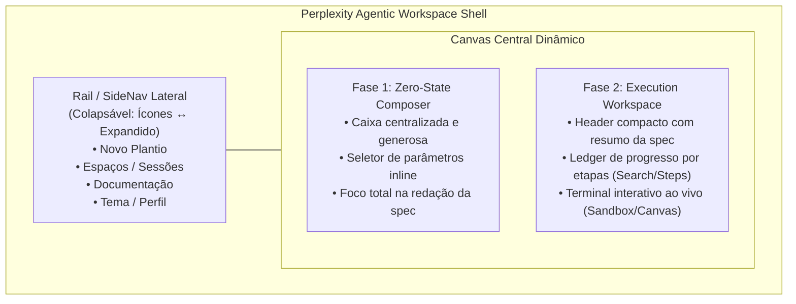

# 🎨 Sprout: Agentic Workspace Shell (Padrão Perplexity.ai)

> **Autor:** Sally (UX Designer & UI Specialist — BMad Method)  
> **Status:** Proposta de UX e Plano de Implementação para Revisão  
> **Iniciativa:** `initiative-sprout-ui` ("Plantar e assistir")  
> **Design System:** Astryx (@astryxdesign/core + temas oficiais)  

---

## 1. Visão Geral e Objetivo

O objetivo deste plano é redesenhar a experiência e a arquitetura visual da interface web do Sprout (`ui/`), adotando o padrão moderno de **Agentic Workspace Shell** consagrado pelo **[Perplexity.ai](https://www.perplexity.ai/)**, mantendo rigorosamente **todos os elementos e comportamentos do escopo inicial** definidos em `docs/plans/sprout-ui-reference.md`, `DESIGN.md` e `EXPERIENCE.md`.

No protótipo anterior, a tela apresentava um formulário tradicional em duas colunas estáticas (Projeto à esquerda, Agente à direita). Com a evolução para o modelo Perplexity, transformamos a interface em uma **estação de trabalho viva para agentes**, onde o usuário transita naturalmente de uma **experiência de entrada focada e minimalista (Zero-State Composer)** para um **canvas de execução orquestrado (Active Agentic Thread + Sandbox Terminal)**.

---

## 2. Análise de UX: O Padrão Perplexity.ai

O Perplexity.ai resolve com elegância o atrito cognitivo entre "fazer uma pergunta/descrever uma tarefa" e "acompanhar uma execução multi-etapas com ferramentas". Sua arquitetura espacial é fundamentada em três pilares:



### Anatomia Comparada

| Dimensão | Perplexity.ai | Sprout Atual (Duas Colunas) | Sprout Proposto (Agentic Shell) |
|---|---|---|---|
| **Navegação & Shell** | Trilho lateral persistente (`SideNav`), colapsável em barra fina de ícones, liberando foco. | Cabeçalho superior estático (`TopNav`), sem barra lateral. | `AppShell` do Astryx com `SideNav` lateral colapsável/redimensionável, com ação "Novo Plantio", links de contexto e `ThemePicker` no rodapé. |
| **Entrada da Ideia (Zero-State)** | Caixa de prompt centralizada, minimalista, limpa, com badges contextuais anexados. | Formulário denso ocupando coluna lateral esquerda com botões e campos verticais. | Hero Composer centralizado e acolhedor: TextArea amplo para a spec Markdown, com controles de destino e escolha de agente embutidos ergonomicamente. |
| **Momento de Transição** | Ao enviar, o formulário se contrai suavemente para um breadcrumb/resumo no topo. | O formulário é substituído por um texto simples de resumo na coluna esquerda. | Transição fluida: a spec enviada vira um Card de resumo no topo, e o canvas abre espaço para o feed de execução e terminal. |
| **Acompanhamento de Execução** | Lista de etapas expansíveis ("Searching...", "Reading...", "Executing..."). | Lista de texto simples com status dots em coluna estática à direita. | Feed sequencial de marcos do agente (Git criado, spec salva, workspace aberto, agente iniciado) em formato de feed de ferramentas/etapas. |
| **Área Interativa (Sandbox)** | Painel lateral/direito de artefatos, código ou execução interativa. | Terminal embutido xterm dentro do Card direito. | Painel Sandbox dominante com terminal xterm de alta legibilidade, com indicador pulsante de agente e atalho claro de saída (`Ctrl+Shift+Espaço`). |

---

## 3. Preservação do Escopo Inicial ("Plantar e assistir")

Nenhum requisito da especificação original é descartado. Todas as regras acordadas continuam operantes:

1. **Apenas Astryx as shipped (`DESIGN.md`):** Zero CSS proprietário, zero classes utilitárias ou regras arbitrárias. Toda a casca é composta exclusivamente por componentes `@astryxdesign/core` (`AppShell`, `SideNav`, `Card`, `Button`, `TextArea`, `TextInput`, `Selector`, `StatusDot`, `Banner`, `Spinner`, `Kbd`, `Code`, `Text`, `Heading`, `Layout`).
2. **Entrada de Spec Markdown:** Textarea com suporte a qualquer tamanho, contagem de caracteres em tempo real e envio por `Ctrl+Enter` ou botão "Plantar".
3. **Sugestão Inteligente de Destino:** `suggestDest` e `slugify` continuam gerando `~/workspace/<slug>` automaticamente a partir do `# Título` do Markdown até que o usuário edite manualmente.
4. **Seletor de Agente:** Opções `auto`, `claude`, `agy`, `codex` e `nenhum` (somente repositório, sem agente).
5. **Feed de Log em Tempo Real:** Registro sequencial com marcadores acessíveis `[info]`, `[ok]`, `[aviso]`, `[erro]` e `StatusDot` com `aria-live="polite"`.
6. **Terminal Interativo:** Componente xterm lazy-loaded que consome tokens de tema do Astryx, recebe teclado real e suporta o atalho de desengate `Ctrl+Shift+Espaço`.
7. **Tratamento de Exceções & Falhas:** Banners e mensagens explicativas para pasta ocupada, ausência do Herdr, encerramento de painel e simulação de cenários (`?cenario=ok|erro|sem-herdr`).
8. **Theme & Color Mode:** Seletor de temas Astryx (`neutral`, `butter`, `chocolate`, `gothic`, `matcha`, `stone`, `y2k`) e modos claro/escuro/sistema preservados.

---

## 4. Arquitetura da Solução & Design dos Estados

### Estado A: Zero-State (Landing / Composer Centralizado)

Quando o usuário entra no Sprout (`sprout ui`), ele não é confrontado com um painel de agente vazio à direita nem com uma tela confusa. Ele encontra uma tela limpa, ampla e focada, exatamente como a home do Perplexity:

```text
+---------------------------------------------------------------------------------------+
| [SideNav (Ícones/Expandido)] |                                                        |
| +--------------------------+ |                    SPROUT                              |
| | [+] Novo Plantio         | |      Da ideia ao agente trabalhando em segundos        |
| |                          | |                                                        |
| | [O] Workspace            | |   +------------------------------------------------+   |
| | [?] Documentação         | |   | Descreva o projeto em Markdown...              |   |
| |                          | |   |                                                |   |
| |                          | |   |                                                |   |
| |                          | |   |                                                |   |
| |                          | |   | ---------------------------------------------- |   |
| | [Tema: Neutral] [Modo]   | |   | Destino: [~/workspace/meu_app] [Agente: auto v]|   |
| | [<<] Recolher            | |   | [Ctrl+Enter envia]                  [ Plantar ]|   |
| +--------------------------+ |   +------------------------------------------------+   |
+---------------------------------------------------------------------------------------+
```

### Estado B: Active Execution (Agentic Workspace Split)

Ao clicar em **Plantar** (ou `Ctrl+Enter`), o hero se recolhe suavemente no topo como um badge de resumo e o workspace se divide no layout Perplexity:

```text
+---------------------------------------------------------------------------------------+
| [SideNav] |  Spec: ~/workspace/meu_app (agente: auto)                [ Plantar outro ]|
|           +-----------------------------------------+---------------------------------+
|           | ETAPAS DO AGENTE                        | TERMINAL DO AGENTE (Sandbox)    |
|           |                                         |                                 |
|           | (•) Repositório git inicializado        | sprout$ reading spec.md...      |
|           | (•) Spec gravada em .sprout/spec.md     | > BMad Method: Sofia ativada.   |
|           | (•) Commit inicial realizado            | > Analisando escopo do app...   |
|           | (•) Workspace Herdr conectado           |                                 |
|           | (*) Agente em execução (PID 4821)       | Posso seguir com o plano? (s/n) |
|           |                                         | █                               |
|           | [Spinner] Plantando...                  +---------------------------------+
|           |                                         | [Ctrl+Shift+Espaço] sai         |
+---------------------------------------------------------------------------------------+
```

---

## 5. User Review Required

> [!IMPORTANT]
> **1. Adoção da `SideNav` do Astryx:**
> O padrão Perplexity utiliza um trilho lateral colapsável. O Astryx possui o componente nativo `SideNav` com propriedades `collapsible={true}` e `resizable={true}`. Isso substitui a navegação pura de `TopNav` como âncora principal, tornando o topo muito mais limpo e focado no conteúdo.
> 
> **2. Estrutura do Teste Unitário (`plant.test.tsx`):**
> No handoff anterior, os testes de `PlantScreen` falhavam porque o hook `useThemeSettings()` exigia o `ThemeSettingsProvider`. Ajustaremos o hook para retornar um contexto seguro (default fallback) caso renderizado isoladamente em testes, garantindo 100% de cobertura e estabilidade sem acoplamento forçado.

---

## 6. Mudanças Propostas

### Camada de Tema & Contexto

#### [MODIFY] `ui/app/shared/theme/theme-settings.tsx`
- Permitir valor default graceful quando chamado fora de `ThemeSettingsProvider` (essencial para testes isolados de componentes).

---

### Camada de Rotas & Componentes

#### [MODIFY] `ui/app/features/plant/routes/plant.tsx`
- Integrar `SideNav` colapsável do Astryx no slot `sideNav` do `AppShell`.
- Redesenhar `PlantScreen`:
  - Se `showForm` for verdadeiro e o estado estiver limpo (`idle`): exibir o **Centered Hero Composer**, integrando textarea, inputs contextuais de destino e agente em um card elegante e convidativo.
  - Se estiver em execução (`planting`, `running`, `no-agent`): renderizar o **Agentic Execution Split Workspace**, com o feed de progresso do plantio à esquerda e o terminal xterm à direita (ou empilhado em telas menores).
  - Incluir botões de atalho no SideNav ("Novo Plantio" que executa `reset()`, Documentação, e `ThemePicker` no rodapé).

#### [MODIFY] `ui/app/features/plant/routes/plant.test.tsx`
- Atualizar os testes unitários para validar a nova casca, a navegação lateral e a transição entre Zero-State e Execution Split.

---

### Camada de Documentação de UX

#### [MODIFY] `_bmad-output/initiative-sprout-ui/ux-plant-and-watch/DESIGN.md`
- Atualizar o documento de Design para registrar a adoção do padrão Agentic Workspace Shell (Perplexity-inspired) com `SideNav` e layout adaptativo de duas fases.

#### [MODIFY] `_bmad-output/initiative-sprout-ui/ux-plant-and-watch/EXPERIENCE.md`
- Atualizar o spine de experiência refletindo a nova jornada: Landing Composer → Execution Split.

---

## 7. Plano de Verificação

### Testes Automatizados
```bash
# 1. Executar testes unitários da UI
cd ui && bun test

# 2. Executar checagem de tipos TypeScript
cd ui && bun run typecheck

# 3. Validar build do Vite / React Router SPA
cd ui && bun run build
```

### Verificação Manual
1. Iniciar servidor local: `cd ui && bun run dev` (ou via servidor Sprout).
2. Acessar `http://localhost:5173/?cenario=ok`:
   - Conferir o **Zero-State**: caixa centralizada, campos de destino e agente bem posicionados.
   - Digitar `# Micro SaaS de Cobrança`: conferir preenchimento automático de `~/workspace/micro_saas_de_cobranca`.
   - Pressionar `Ctrl+Enter`: observar a transição fluida para o Workspace de Execução.
   - Verificar as etapas de log aparecendo sequencialmente.
   - Interagir com o terminal xterm: digitar respostas e comandos, testar `Ctrl+Shift+Espaço` para soltar o foco.
3. Testar colapso da `SideNav` (botão de recolher na barra lateral).
4. Testar os cenários alternativos:
   - `?cenario=erro`: verificar o retorno seguro ao formulário com o erro preservado.
   - `?cenario=sem-herdr`: verificar o banner orientativo mantendo os dados da spec acessíveis.
5. Alternar temas no `ThemePicker` e verificar adaptação do terminal e componentes.
