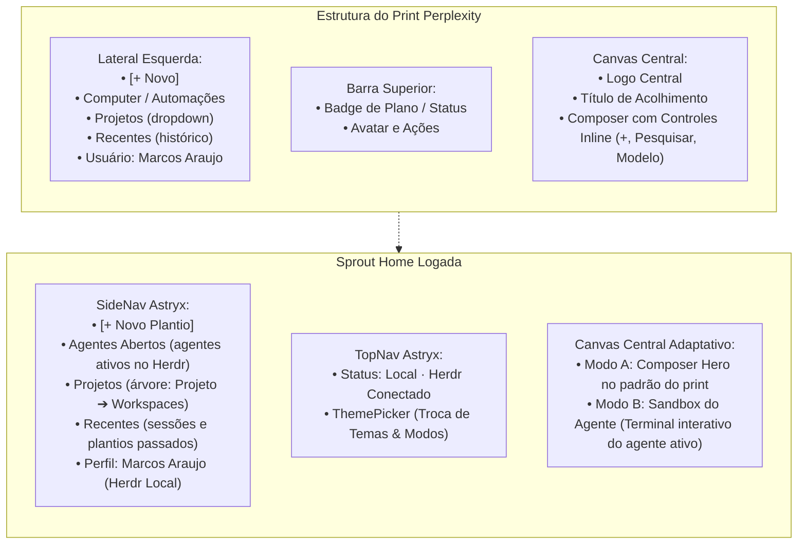

# 🎨 Sprout: Home Logada & Agentic Workspace (Padrão Visual do Print)

> **Autor:** Sally (UX Designer & UI Specialist — BMad Method)  
> **Status:** Proposta de UX e Plano de Implementação para Aprovação  
> **Iniciativa:** `initiative-sprout-ui` (Expansão para Home Logada & Multi-Workspace)  
> **Design System:** Astryx (@astryxdesign/core + temas oficiais)  

---

## 1. Visão Geral e Objetivo

O usuário solicitou expandir a experiência atual do Sprout aplicando **a estrutura exata do print de referência** (interface do Perplexity Computer em modo escuro/logado), transformando a aplicação em uma **Home Logada completa para orquestração de agentes e projetos**.

### Principais Necessidades Atendidas:
1. **Sidebar Lateral Esquerda:**
   - **Agentes Abertos:** Visualização em tempo real de todos os agentes em execução (com status pulsante, nome do agente e terminal acessível em 1 clique).
   - **Projetos e Múltiplos Espaços de Trabalho (Workspaces):** Visualização hierárquica onde o usuário pode alternar entre projetos (ex: `sprout`, `finance_tool`), e cada projeto pode conter múltiplos workspaces (Git worktrees/branches como `feat/sprout-ui`, `main`, `fix/FT-123`).
   - **Histórico de Conversa (Recentes):** Lista de sessões anteriores com timestamps relativos.
   - **Rodapé do Usuário:** Perfil (`Marcos Araujo · Local · Herdr ativo`) e acesso a configurações/tema.
2. **Canvas Central Dinâmico:**
   - **Modo Composer (Home Logada):** Card centralizado idêntico ao do print, com contorno arredondado, textarea para Markdown ("Descreva o que vamos construir..."), barra inferior de controles contextuais (anexar contexto, destino sugerido, dropdown de agente/modelo, atalho `Ctrl+Enter`).
   - **Modo Terminal Interativo:** Ao clicar em qualquer agente aberto na barra lateral ou ao plantar uma nova spec, o canvas central abre o terminal ao vivo (`xterm`) do agente selecionado, com cabeçalho de navegação (breadcrumb de projeto/workspace) e capacidade de alternar entre agentes sem perder estado.
3. **Fidelidade ao Astryx:** Toda a composição utiliza estritamente componentes do `@astryxdesign/core` (`AppShell`, `SideNav`, `SideNavItem`, `SideNavSection`, `Card`, `Button`, `TextArea`, `TextInput`, `Selector`, `StatusDot`, `Badge`, `Avatar`, `Grid`, `HStack`, `VStack`, `Center`).

---

## 2. Análise do Print e Mapeamento de UX

Abaixo analisamos a correlação direta entre o print fornecido pelo usuário e a arquitetura do Sprout:



---

## 3. Modelo de Informação & Estado

Para permitir alternar entre projetos e ver seus múltiplos espaços de trabalho, definimos a estrutura de dados:

```ts
export interface AgentSession {
  id: string;
  name: string; // ex: "agent-sprout", "agent-billing"
  agent: AgentChoice; // "auto" | "claude" | "agy" | "codex"
  paneId: string;
  projectId: string;
  workspaceId: string;
  status: "running" | "idle" | "stopped";
  startedAt: string;
}

export interface Workspace {
  id: string;
  name: string; // ex: "feat/sprout-ui", "main", "billing_prd"
  branch: string;
  path: string;
  activeAgent?: AgentSession;
}

export interface Project {
  id: string;
  name: string; // ex: "sprout", "finance_tool"
  path: string;
  workspaces: Workspace[];
}

export interface RecentSession {
  id: string;
  title: string;
  projectId: string;
  workspaceId: string;
  updatedAt: string;
}
```

### Estado de Navegação do Shell
- `activeProjectId`: ID do projeto atualmente selecionado (ex: `"sprout"`).
- `activeWorkspaceId`: ID do workspace selecionado dentro do projeto (ex: `"feat/sprout-ui"`).
- `activeView`: `"composer"` (para criar nova spec ou nova sessão) ou `"terminal"` (para interagir com um agente).
- `activeAgentPaneId`: Pane do terminal atualmente em foco na tela central.

---

## 4. Jornada do Usuário & Telas

### Fluxo 1: Home Logada (Zero-State do Workspace)
1. Marcos abre o Sprout (`sprout ui`).
2. A barra lateral exibe:
   - **Agentes Abertos:** Mostra `agent-sprout` (com status dot verde pulsante) e `agent-billing`.
   - **Projetos:** Lista expansível com `sprout` (workspaces: `feat/sprout-ui`, `main`) e `finance_tool` (workspaces: `billing_prd`, `main`).
   - **Recentes:** Últimas sessões gravadas.
3. O centro exibe a Home do Workspace no layout exato do print:
   - Emblema central do Sprout.
   - Saudação: "Sprout Workspace · Projeto sprout / feat/sprout-ui".
   - Composer estético com textarea Markdown ("O que vamos construir?"), chips de destino e agente, e botão de envio rápido (`Ctrl+Enter`).

### Fluxo 2: Alternância para um Agente em Execução
1. Marcos clica em `agent-sprout` na seção **Agentes Abertos** da barra lateral.
2. O canvas central transiciona para o **Terminal Interativo do Agente**:
   - Cabeçalho exibe: `sprout > feat/sprout-ui > agent-sprout` com `StatusDot` pulsante.
   - O terminal xterm responde imediatamente às teclas de Marcos.
   - Um botão `Novo Prompt / Composer` ou `+ Novo` permite voltar ao compositor a qualquer instante sem interromper o agente.

### Fluxo 3: Alternância entre Projetos e Espaços de Trabalho
1. Marcos clica no projeto `finance_tool` na barra lateral.
2. A lista expande exibindo seus workspaces: `billing_prd` e `main`.
3. Ao clicar em `billing_prd`, o Sprout comuta o contexto ativo para o `finance_tool / billing_prd`. Como há um agente ativo nesse workspace (`agent-billing`), o terminal correspondente já é carregado.

---

## 5. User Review Required

> [!IMPORTANT]
> **1. Preservação do Fluxo de Testes do Protótipo:**
> O endpoint simulado `?cenario=ok|erro|sem-herdr` e todos os 30 testes unitários existentes continuarão 100% operantes. A nova estrutura de projetos e workspaces fornecerá dados ricos por padrão, integrados ao `ApiProvider`.
>
> **2. Navegação Sem Recarregar:**
> A alternância entre agentes e projetos ocorre em memória através de estado reativo, garantindo transições instantâneas (<50ms) entre o Composer e o Terminal xterm.

---

## 6. Mudanças Propostas

### Camada de Tipos e Mock de Workspace

#### [NEW] `ui/app/features/plant/api/workspace-data.ts`
- Dados mockados padrão com projetos reais do ecossistema do usuário (`sprout`, `finance_tool`), múltiplos workspaces (`feat/sprout-ui`, `main`, `billing_prd`) e agentes ativos.
- Suporte a adicionar novos projetos/workspaces dinamicamente ao plantar.

#### [MODIFY] `ui/app/features/plant/api/types.ts`
- Exportar tipos de `Project`, `Workspace`, `AgentSession` e `RecentSession`.

---

### Camada de Componentes da Interface

#### [MODIFY] `ui/app/features/plant/routes/plant.tsx`
- Atualizar a `SideNav` do `AppShell` para incluir:
  - Seção **Agentes Abertos** com status dot pulsante e atalho para focar o terminal.
  - Seção **Projetos** com suporte a itens colapsáveis (`SideNavItem` aninhado) listando múltiplos workspaces por projeto.
  - Seção **Recentes** com histórico de sessões.
  - Rodapé de usuário (`Avatar` de Marcos Araujo + status local do Herdr).
- Atualizar o Canvas Central:
  - Composer estilizado no visual exato do print (barra de ferramentas inline com destino, seletor de modelo/agente, atalho `Ctrl+Enter`).
  - Alternância limpa entre visualização do Composer e visualização do Terminal do Agente selecionado.

#### [MODIFY] `ui/app/features/plant/routes/plant.test.tsx`
- Adicionar testes unitários para:
  - Renderização dos agentes abertos na barra lateral.
  - Alternância de projetos e workspaces na barra lateral.
  - Abertura direta do terminal de um agente a partir do clique na sidebar.
  - Retorno ao Composer via botão `+ Novo`.

---

## 7. Plano de Verificação

### Testes Automatizados
```bash
# 1. Executar suíte completa de testes unitários
cd ui && bun test

# 2. Checagem estrita de tipos TypeScript
cd ui && bun run typecheck

# 3. Build de produção do React Router SPA
cd ui && bun run build
```

### Verificação Manual
1. Iniciar servidor: `cd ui && bun run dev`
2. Acessar `http://localhost:5173/`:
   - Conferir na lateral esquerda os **Agentes Abertos** (`agent-sprout`, `agent-billing`).
   - Conferir a árvore de **Projetos** e seus múltiplos **Espaços de Trabalho**.
   - Clicar em um agente aberto e validar se o canvas central abre o terminal interativo correspondente.
   - Clicar em `+ Novo` e validar o retorno ao Composer no padrão estético do print.
   - Alternar de projeto na sidebar e conferir a atualização do contexto no cabeçalho.
