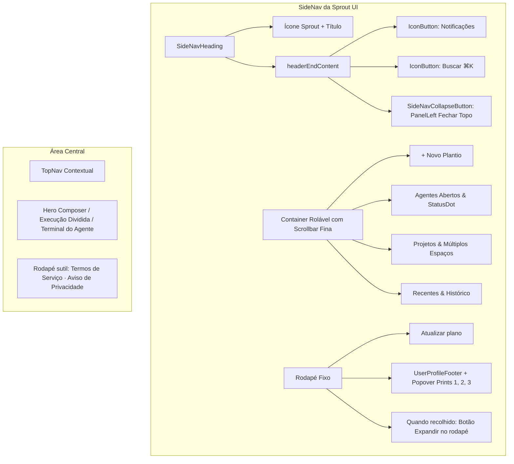

# Plano: Alinhamento Estrutural da Sprout UI com FinOps e Perplexity.ai

> **Persona**: Sally (`🎨`), Especialista em UX/UI & Design Systems (BMAD)  
> **Status**: Aguardando aprovação do usuário para execução  
> **Diretiva de Design**: Replicar estritamente a **estrutura de layout, mecânicas de interação e organização de elementos** do `@finops` (`ft_bpo_shell/apps/finops/app/features/workspace/components/BpoSidebar.tsx`) e `Perplexity.ai`, mantendo **100% intactos** o tema visual ativo (**Y2K Dark** por padrão) e os tokens de design do Astryx.

---

## 1. Diagnóstico do Estado Atual vs. FinOps

| Elemento | Sprout UI Atual | Padrão FinOps (`BpoSidebar.tsx`) / Perplexity | Alinhamento Proposto |
|---|---|---|---|
| **Botão de Fechar Menu** | No rodapé (`footerIcons`) do `SideNav` | No **topo** do menu, no cabeçalho `SideNavHeading` via prop `headerEndContent`, com ícone `PanelLeft` | Adicionar `SideNavCollapseButton` com ícone `PanelLeft` no `headerEndContent` do `SideNavHeading`. Quando recolhido, exibir botão de re-expansão no rodapé. |
| **Cabeçalho da Sidebar** | Apenas título e subtítulo sem ações no canto direito | Marca/Logo + Título + Ações rápidas no canto superior direito (`HStack` com Notificações, Busca `⌘K` e Fechar Menu) | Implementar `headerEndContent` completo com `Bell`, `Search` e `SideNavCollapseButton`. |
| **Controle de Colapso** | `collapsible={true}` implícito | `collapsible={{ isCollapsed, onCollapsedChange: setIsCollapsed, hasButton: false }}` | Estado controlado com `useState(false)` e `hasButton: false`, eliminando botões automáticos indesejados. |
| **Scrollbar do Menu** | Scrollbar nativa do navegador (pode parecer espessa no desktop) | Scrollbar discreta, minimalista e transparente (`scrollbar-width: thin`, webkit 5px, trilho transparente, thumb arredondado) | Injetar CSS utilitário de scrollbar fina aderente aos tokens do tema (`var(--color-border-subtle)` / `var(--color-border)`). |
| **Rodapé do Canvas** | Sem rodapé institucional | Links sutis centralizados no rodapé (*Termos de Serviço · Aviso de Privacidade*) como no Perplexity/FinOps | Adicionar rodapé discreto na base do canvas quando no modo Zero-State / Composer. |
| **Temas e Paleta** | Y2K Dark (`@astryxdesign/theme-y2k`) | `finops-bpo` (azul/cinza) | **Manter Y2K Dark intacto** conforme solicitado expressamente pelo usuário. |

---

## 2. Arquitetura da Solução



---

## 3. Plano de Mudanças Detalhado

### 3.1. `ui/app/shared/theme/sprout-shell.css` (Novo Arquivo)
Criar folha de estilo específica para o shell da aplicação com as propriedades de scrollbar customizada do menu:
```css
/* Scrollbar fina e minimalista inspirada no FinOps e Perplexity */
.astryx-side-nav div[class*="scrollable"],
.astryx-side-nav [data-scrollable],
.sprout-sidebar-scroll {
  scrollbar-width: thin;
  scrollbar-color: var(--color-border-subtle, rgba(255, 255, 255, 0.16)) transparent;
}

.astryx-side-nav div[class*="scrollable"]::-webkit-scrollbar,
.astryx-side-nav [data-scrollable]::-webkit-scrollbar,
.sprout-sidebar-scroll::-webkit-scrollbar {
  width: 5px;
  height: 5px;
}

.astryx-side-nav div[class*="scrollable"]::-webkit-scrollbar-track,
.astryx-side-nav [data-scrollable]::-webkit-scrollbar-track,
.sprout-sidebar-scroll::-webkit-scrollbar-track {
  background: transparent;
}

.astryx-side-nav div[class*="scrollable"]::-webkit-scrollbar-thumb,
.astryx-side-nav [data-scrollable]::-webkit-scrollbar-thumb,
.sprout-sidebar-scroll::-webkit-scrollbar-thumb {
  background: var(--color-border-subtle, rgba(255, 255, 255, 0.18));
  border-radius: 9999px;
  transition: background-color 0.2s ease;
}

.astryx-side-nav div[class*="scrollable"]::-webkit-scrollbar-thumb:hover,
.astryx-side-nav [data-scrollable]::-webkit-scrollbar-thumb:hover,
.sprout-sidebar-scroll::-webkit-scrollbar-thumb:hover {
  background: var(--color-border, rgba(255, 255, 255, 0.38));
}
```
Importar no `ui/app/root.tsx` após os arquivos do Astryx.

---

### 3.2. `ui/package.json`
- Adicionar `"lucide-react": "^1.32.0"` às dependências diretas de `ui/package.json` para suportar `PanelLeft`, `Bell`, `Search` e `Sparkles`.

---

### 3.3. `ui/app/features/plant/routes/plant.tsx`
- **Estado de colapso controlado**:
  ```tsx
  const [isCollapsed, setIsCollapsed] = useState(false);
  const collapsible = useMemo(
    () => ({ isCollapsed, onCollapsedChange: setIsCollapsed, hasButton: false }),
    [isCollapsed]
  );
  ```
- **Cabeçalho com botão de recolher no topo**:
  ```tsx
  <SideNav
    collapsible={collapsible}
    header={
      <SideNavHeading
        heading="Sprout"
        icon={<Sparkles size={20} strokeWidth={1.75} className="text-[var(--color-icon-accent)]" />}
        headerEndContent={
          <HStack gap={0.5} align="center">
            <IconButton
              label="Notificações"
              tooltip="Notificações"
              variant="ghost"
              size="sm"
              icon={<Bell size={16} strokeWidth={1.75} />}
            />
            <IconButton
              label="Buscar comandos"
              tooltip="Buscar (⌘K)"
              variant="ghost"
              size="sm"
              icon={<Search size={16} strokeWidth={1.75} />}
            />
            <SideNavCollapseButton collapsible={collapsible} size="sm">
              <PanelLeft size={16} strokeWidth={1.75} aria-hidden />
            </SideNavCollapseButton>
          </HStack>
        }
      />
    }
    footerIcons={
      isCollapsed ? (
        <SideNavCollapseButton collapsible={collapsible} />
      ) : undefined
    }
    footer={
      <UserProfileFooter
        slug={slug}
        effectiveMode={effectiveMode}
        setSlug={setSlug}
        setMode={setMode}
      />
    }
  >
  ```
- **Rodapé institucional no Canvas**:
  No rodapé do Hero Composer:
  ```tsx
  <footer className="mt-8 text-center text-xs text-[var(--color-text-secondary)]">
    <HStack justify="center" gap={3}>
      <Text size="sm" type="supporting">Termos de Serviço</Text>
      <Text size="sm" type="supporting">·</Text>
      <Text size="sm" type="supporting">Aviso de Privacidade</Text>
    </HStack>
  </footer>
  ```

---

### 3.4. `ui/app/features/plant/routes/plant.test.tsx`
- Adicionar testes automatizados:
  1. Verificar que o botão de recolher menu com ícone `PanelLeft` (`SideNavCollapseButton`) está renderizado no topo (`SideNavHeading` -> `headerEndContent`).
  2. Testar o clique no botão de recolher menu e a alternância do estado.
  3. Garantir que todas as 33 asserções existentes permanecem 100% verdes.

---

## 4. Plano de Verificação

1. **Testes Unitários**: `cd ui && bun test`
   - Deve passar em todos os testes (33+ testes).
2. **Typecheck Rigoroso**: `cd ui && bun run typecheck`
   - Zero erros no compilador TypeScript.
3. **Build de Produção**: `cd ui && bun run build`
   - O bundle Vite deve compilar sem avisos ou falhas.
4. **Verificação Visual e Interativa**:
   - Botão no canto superior direito do menu fecha o menu suavemente.
   - Menu recolhido exibe botão de expansão no rodapé.
   - Scrollbar do menu exibe comportamento minimalista e fino sem trilho cinza bruto.
   - Tema Y2K Dark permanece inalterado.

---

> [!IMPORTANT]
> Estamos em modo `/plan`. Nenhuma linha de código foi alterada nesta etapa. Por favor, revise o plano e autorize a implementação para prosseguirmos!
