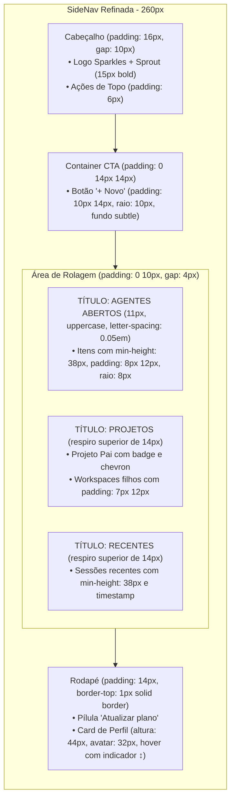

# Plano: Refinamento de Densidade, Espaçamento e Aparência da SideNav (Base: Protótipo BPO Shell)

> **Persona:** Sally (`🎨`), Especialista em UX/UI & Design Systems (BMad Method)  
> **Referência:** `file:///home/mraraujo/workspace/ft_bpo_shell/docs/demo/bpo_workspace_shell_prototype.html`  
> **Status:** Aguardando aprovação para implementação  

---

## 1. Diagnóstico: Protótipo BPO Shell vs. Sprout UI Atual

O protótipo [`bpo_workspace_shell_prototype.html`](file:///home/mraraujo/workspace/ft_bpo_shell/docs/demo/bpo_workspace_shell_prototype.html) estabelece um padrão visual arejado, com áreas de clique amplas, ritmo vertical bem balanceado e excelente hierarquia tipográfica:

| Componente / Elemento | Sprout UI Atual (Astryx Padrão) | Protótipo BPO Shell (`.sidebar`) | Alinhamento Proposto |
|---|---|---|---|
| **Largura da Sidebar** | 240px / 260px variável | `width: 260px;` fixo e estruturado | Fixar largura de 260px com transição suave para colapso |
| **Cabeçalho (`SideNavHeading`)** | Padding 8px compacto | `padding: 16px;` com gap 10px entre ícone e marca; botões com padding 6px | Expandir padding para 14–16px e gap de 10px |
| **Botão "+ Novo"** | Botão primário com fundo sólido e altura padrão | `.cta-container` (padding `0 14px 14px`) + `.btn-new-chat` com padding `10px 14px`, raio 10px, fundo `subtle`, borda 1px e texto 13px peso 600 | Adicionar `.sprout-btn-new` integrado organicamente à paleta Y2K com padding `10px 14px` e borda suave |
| **Itens de Menu (`SideNavItem`)** | Altura padrão ~32–36px, padding vertical zero, itens colados | `.nav-item`: padding `8px 12px`, `min-height: 38px`, raio 8px, gap 10px, fonte 13px | Aplicar `min-height: 38px`, padding `8px 12px`, raio 8px e gap entre itens de 3–4px |
| **Títulos de Seção** | Compacto, colado nos itens | `.section-title`: 11px uppercase, letter-spacing 0.05em, padding `12px 14px 6px 14px` | Criar respiro vertical antes de cada seção (`padding: 12px 10px 6px 10px`) |
| **Accordion de Projetos/Workspaces** | Itens filhos densos | Recuo limpo, `min-height: 36px`, padding `6px 12px` | Proporcionar espaçamento interno confortável aos itens filhos |
| **Rodapé do Menu Lateral** | Padding 8px compacto | `.sidebar-footer`: padding 14px, borda superior 1px, gap 8px | Wrapper `.sprout-sidebar-footer` com padding 14px e borda superior divisória |

---

## 2. Mapa Visual das Alterações



---

## 3. Arquivos a Modificar

### 3.1. `ui/app/shared/theme/sprout-shell.css`
Incorporar as regras CSS exatas do protótipo que vencem os estilos base sem ferir a integridade do Astryx:

```css
/* =========================================================================
   Sidebar: Densidade, Espaçamento e Proporções do Protótipo
   (bpo_workspace_shell_prototype.html)
   ========================================================================= */

/* 1. Estrutura geral e largura da sidebar expandida */
.astryx-side-nav {
  width: 260px !important;
  min-width: 260px;
}

/* 2. Cabeçalho da sidebar */
.astryx-side-nav-heading {
  padding: 14px 14px 12px 14px !important;
  min-height: 52px;
}

/* 3. Área do CTA / Botão "+ Novo" (.cta-container & .btn-new-chat) */
.sprout-sidebar-cta {
  padding: 0 12px 12px 12px;
}

.sprout-btn-new {
  display: flex;
  align-items: center;
  justify-content: flex-start;
  gap: 8px;
  width: 100%;
  padding: 10px 14px !important;
  min-height: 42px !important;
  border-radius: 10px !important;
  font-size: 13px !important;
  font-weight: 600 !important;
  background-color: var(--color-background-muted, #1f242d) !important;
  border: 1px solid var(--color-border, #2a313d) !important;
  color: var(--color-text-primary, #f3f4f6) !important;
  transition: all 0.15s ease-in-out;
  cursor: pointer;
}

.sprout-btn-new:hover {
  background-color: var(--color-background-card, #262c37) !important;
  border-color: var(--color-border-emphasized, #6b7280) !important;
  color: var(--color-text-primary, #ffffff) !important;
}

/* 4. Espaçamento da área de rolagem */
.astryx-side-nav div[class*="scrollable"],
.astryx-side-nav [data-scrollable] {
  padding: 0 10px !important;
}

.astryx-side-nav-section {
  margin-bottom: 12px !important;
}

/* 5. Títulos de seção (.section-title do protótipo) */
.astryx-side-nav-section [id$="-title"],
.astryx-side-nav-section > div:first-child span {
  font-size: 11px !important;
  font-weight: 700 !important;
  text-transform: uppercase !important;
  letter-spacing: 0.05em !important;
  color: var(--color-text-secondary, #9ca3af) !important;
  opacity: 0.85;
  padding: 12px 8px 6px 8px !important;
}

/* 6. Itens de Menu (.nav-item e .thread-item do protótipo) */
.astryx-side-nav-item {
  min-height: 38px !important;
  padding: 8px 12px !important;
  border-radius: 8px !important;
  margin-bottom: 3px !important;
  font-size: 13px !important;
  font-weight: 500 !important;
  gap: 10px !important;
  color: var(--color-text-secondary, #9ca3af) !important;
  transition: all 0.15s ease-in-out !important;
}

.astryx-side-nav-item:hover {
  background-color: var(--color-background-muted, #1f242d) !important;
  color: var(--color-text-primary, #f3f4f6) !important;
}

.astryx-side-nav-item[aria-current="page"],
.astryx-side-nav-item[data-selected="true"],
.astryx-side-nav-item[class*="selected"] {
  background-color: var(--color-background-muted, #1f242d) !important;
  color: var(--color-text-primary, #ffffff) !important;
  font-weight: 600 !important;
}

/* Ícones dos itens */
.astryx-side-nav-item svg,
.astryx-side-nav-item i {
  width: 16px !important;
  height: 16px !important;
  flex-shrink: 0;
  stroke-width: 1.75;
}

/* 7. Rodapé do Menu Lateral (.sidebar-footer do protótipo) */
.sprout-sidebar-footer {
  padding: 14px 12px 12px 12px;
  border-top: 1px solid var(--color-border, #2a313d);
  display: flex;
  flex-direction: column;
  gap: 8px;
}
```

---

### 3.2. `ui/app/features/plant/routes/plant.tsx`
- Atualizar a prop `topContent` da `SideNav` para usar a classe `.sprout-sidebar-cta` e o botão estilizado `.sprout-btn-new` (com ícone `Plus`).
- Envolver o rodapé com a classe `.sprout-sidebar-footer` para aplicar a borda superior e o padding de 14px do protótipo.
- Garantir que todos os `SideNavItem` utilizem o novo dimensionamento.

---

### 3.3. `ui/app/features/plant/routes/plant.test.tsx`
- Garantir que todas as 36 asserções existentes continuam passando sem regressões.
- Verificar que o botão `+ Novo` continua acessível e executando o reset do formulário normalmente.

---

## 4. Plano de Verificação

1. **Testes Unitários:** `cd ui && bun test`
   - Todos os 36 testes devem passar 100%.
2. **Checagem de Tipos:** `cd ui && bun run typecheck`
   - Zero erros no compilador TypeScript.
3. **Build de Produção:** `cd ui && bun run build`
   - O bundle Vite deve compilar com sucesso.
4. **Inspeção Visual:**
   - O menu lateral ganha respiro evidente: itens com altura de 38px, padding de 8×12px e cantos arredondados de 8px.
   - O botão `+ Novo` adquire o visual elegante do `.btn-new-chat` do protótipo com raio de 10px e fundo suave.
   - Os títulos de seção ganham espaçamento superior bem definido e tipografia refinada.
   - O rodapé fica separado com linha sutil e padding de 14px.

---

> [!IMPORTANT]
> Estamos em modo `/plan`. Por favor, revise os parâmetros de densidade e espaçamento extraídos do protótipo. Se aprovado, autorize para prosseguirmos com a implementação!
