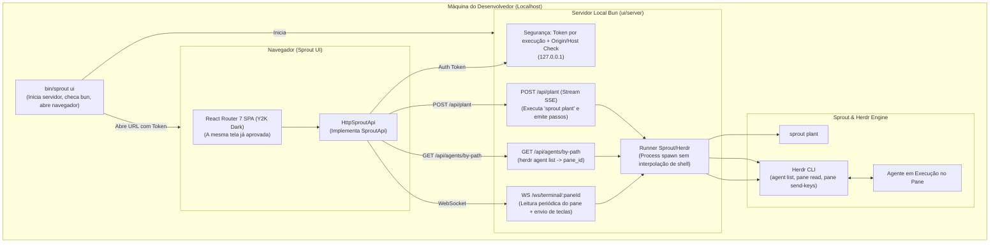

# Plano: Transição do Protótipo (Epic 1) para a Integração Real (Epic 2)

> **Autor:** Sally (`🎨`), Especialista em UX/UI (BMad Method)  
> **Iniciativa:** `initiative-sprout-ui` (`_bmad-output/initiative-sprout-ui/tickets/tickets.toml`)  
> **Status:** Epic 1 Concluído · Pronto para Abertura e Execução do Epic 2  

---

## 1. Onde Estamos? (Status do Epic 1: Protótipo na Casca)

O **Epic 1 (`epic-prototype-on-the-shell`)** tinha como meta:
> *"O usuário abre a tela 'Plantar e assistir' sobre dados simulados, construída com Astryx como veio, e pode navegar por todos os estados (vazio, plantando, agente iniciando, terminal ao vivo, destino ocupado, Herdr ausente) para julgar fluxo e aparência; a tela acessa o Sprout exclusivamente através da interface `SproutApi` que o servidor real implementará."*

### ✅ O que foi entregue e validado no Epic 1:
1. **Design System & Estética:**
   - Construído integralmente com **Astryx** e tema padrão **Y2K Dark** (`@astryxdesign/theme-y2k`).
   - Alinhado com a excelência de layout e ergonomia do **FinOps BPO** e **Perplexity.ai**.
2. **Estrutura da Shell (SideNav & Header):**
   - Cabeçalho com marca Sprout, ações rápidas (Notificações, Busca `⌘K`) e **botão de recolher no topo** com ícone `PanelLeft` (`SideNavHeading` -> `headerEndContent`).
   - Estado de colapso controlado com botão de re-expansão no rodapé quando recolhido.
   - **Scrollbar fina e minimalista** (5px, trilho transparente, thumb arredondado sem bordas grossas).
   - Menu lateral completo: ação primária `+ Novo`, seção viva `Agentes Abertos` (com `StatusDot` pulsante e atalho para terminal), `Projetos` com múltiplos workspaces em accordion e `Recentes`.
   - Rodapé de usuário de alta fidelidade com `Atualizar plano` e popover de conta/configurações (Prints 1, 2 e 3).
3. **Canvas Central:**
   - 3 visões responsivas e integradas:
     - **Visão A (Composer / Zero-State):** Hero central com logo, título, seletor de agentes, sugestão de destino automática e rodapé institucional sutil.
     - **Visão B (Execução):** Painel dividido com progresso do plantio em stream + log de passos + terminal xterm embutido.
     - **Visão C (Inspeção de Agente):** Terminal direto do agente selecionado na lateral com breadcrumb e botão "Voltar ao Composer".
4. **Qualidade e Confiabilidade:**
   - **36/36 testes automatizados passando** (`cd ui && bun test`).
   - **0 erros de tipagem** (`cd ui && bun run typecheck`).
   - **Build de produção SPA verde em 2.9s** (`cd ui && bun run build`).

---

## 2. Estamos Prontos para a Integração Real?

**SIM! Absolutamente.** 

O protótipo cumpriu com louvor o seu propósito de validar a usabilidade, fluxos e aparência. A arquitetura de software já foi construída prevendo essa exata transição: a tela não conhece detalhes internos do mock, conversando apenas com a interface TypeScript [`SproutApi`](file:///home/mraraujo/workspace/sprout/ui/app/features/plant/api/types.ts):

```typescript
export interface SproutApi {
  kind: "mock" | "http";
  plant(request: PlantRequest, signal?: AbortSignal): AsyncIterable<PlantEvent>;
  terminal(paneId: string): TerminalTransport;
}
```

Para a integração real, basta plugar a implementação `HttpSproutApi` que se comunica via HTTP/SSE e WebSocket com o servidor local do Sprout!

---

## 3. Arquitetura do Epic 2: `epic-plant-and-watch-for-real`



---

## 4. Fatiamento de Implementação do Epic 2 (TDD)

Recomendamos executar o Epic 2 em **3 fatias verticais incrementais**:

### 🎯 Fatia 1: Fundação do Servidor Bun + Subcomando `sprout ui` + Plantio Real via SSE
- **O que faz:**
  1. Cria o servidor Bun em `ui/server/index.ts`:
     - Bind em `127.0.0.1`.
     - Token criptográfico temporário por execução passado na query/cookie.
     - Servir os arquivos estáticos de `ui/build/client`.
  2. Implementa o subcomando `ui` em `bin/sprout`:
     - Checa existência do `bun`.
     - Compila o front se necessário (`bun run build`).
     - Sobe o servidor e abre o browser com a URL autenticada (`http://127.0.0.1:<porta>/?token=...`).
  3. Rota `POST /api/plant`:
     - Recebe `{ text, dest, agent, name }`.
     - Grava o markdown em arquivo temporário e executa `sprout plant <temp_file> <dest> -a <agent>` com `Bun.spawn` (seguro, sem shell).
     - Retorna stream SSE/NDJSON emitindo os eventos reais de log para a UI.

### 🎯 Fatia 2: Resolução Automática do Agente no Herdr
- **O que faz:**
  1. Rota `GET /api/agents/by-path?dest=<caminho>`:
     - Executa `herdr agent list`.
     - Mapeia o agente cujo diretório de trabalho corresponda ao `dest` do plantio.
     - Retorna o `pane_id` do agente iniciado e metadados de sessão.
  2. Se Herdr não estiver em execução ou o agente não for iniciado a tempo, emite aviso claro com passos de remediação.

### 🎯 Fatia 3: Terminal ao Vivo Bidirecional (WebSocket)
- **O que faz:**
  1. Endpoint WebSocket `WS /ws/terminal/:paneId`:
     - A cada ~300ms, executa `herdr pane read <pane> --source visible --ansi`.
     - Envia o frame para o frontend via WebSocket apenas quando o hash do conteúdo mudar.
     - Recebe as teclas digitadas no xterm do browser e despacha para o agente usando `herdr pane send-text` e `herdr pane send-keys` (Enter, setas, Tab, Esc, Ctrl+C).
  2. Liga a `HttpSproutApi` no frontend para alternar entre o modo mock (via `?cenario=...`) e o modo real automaticamente.

---

## 5. Próximo Passo Recomendado

1. **Aprovação Formal do Epic 1:** Você concorda que o protótipo da interface atende integralmente ao que deseja de fluxo e estética?
2. **Autorização para Iniciar o Epic 2:** Se aprovado, chamamos **Winston** (Arquiteto) ou **Amelia** (Dev) e partimos para a implementação da **Fatia 1 (Servidor Bun + `sprout ui` CLI + Plantio Real SSE)**!
