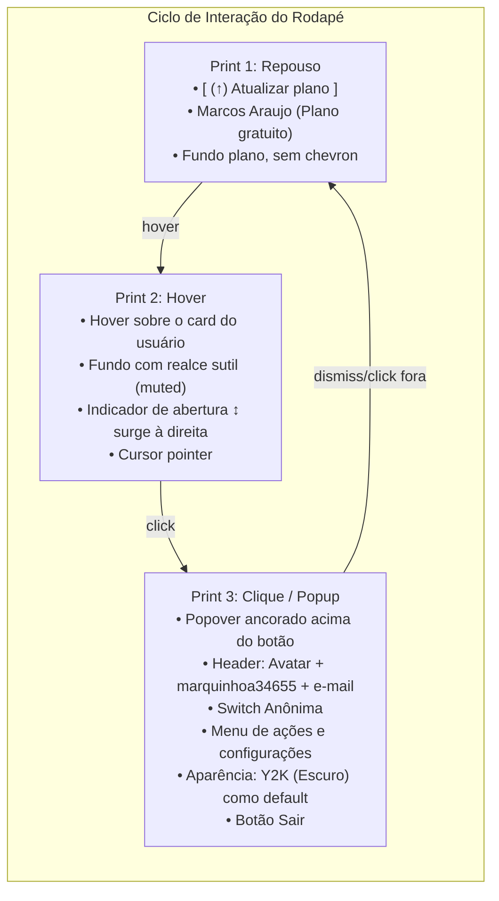

# 🎨 Sprout: Rodapé da SideNav & Popup de Usuário (Padrão Prints 1, 2 e 3)

> **Autor:** Sally (UX Designer & UI Specialist — BMad Method)  
> **Status:** Proposta de UX e Plano de Implementação para Revisão  
> **Iniciativa:** `initiative-sprout-ui` (Rodapé do Shell & Menu de Contexto do Usuário)  
> **Design System:** Astryx (@astryxdesign/core + tema Y2K)  

---

## 1. Visão Geral e Objetivo

O objetivo deste plano é refinar o rodapé da barra lateral (`SideNav`) da Home Logada do Sprout para seguir com máxima fidelidade os **três prints de referência** fornecidos pelo usuário:
1. **Print 1 (Estado de Repouso):** Botão pill superior `(↑) Atualizar plano` e linha de perfil do usuário (`Marcos Araujo · Plano gratuito`) com superfície plana.
2. **Print 2 (Estado de Hover):** Ao passar o mouse sobre a área clicável do usuário, a superfície ganha destaque arredondado sutil (`variant="muted"`) e revela o seletor chevron `↕` no canto direito.
3. **Print 3 (Popup Menu / Popover):** Ao clicar na área do usuário, abre-se um Popover ancorado logo acima (`placement="above"`), contendo:
   - Cabeçalho do usuário com avatar, handle (`marquinhoa34655`) e e-mail (`marquinhoaraujo@gmail.com`).
   - Linha de modo Anônimo com switch liga/desliga (`<Switch />`).
   - Ações de conta: `Adicionar conta`, `Todas as configurações`, `Atualizar plano`, `Instalar aplicativos`.
   - Controle de **Aparência** (configurado com **Y2K escuro** como padrão da aplicação).
   - `Idioma` e `Central de ajuda`.
   - Ação de `Sair`.
4. **Tema Padrão:** Configurar o tema **Y2K** e o modo **escuro (dark)** como padrão nativo do Sprout.

---

## 2. Análise Visual dos 3 Prints



### Detalhamento dos Componentes do Popup (Print 3)

| Elemento | Componente Astryx | Comportamento |
|---|---|---|
| **Superfície Ancorada** | `Popover` (`placement="above"`, `alignment="start"`, `width={290}`) | Abre diretamente sobre o rodapé da SideNav com cantos arredondados do tema Y2K. |
| **Cabeçalho de Usuário** | `HStack` + `Avatar` + `VStack` | Exibe foto/avatar, username `marquinhoa34655` e e-mail `marquinhoaraujo@gmail.com`. |
| **Modo Anônimo** | `HStack` + `Switch` | Alterna modo anônimo/local sem persistência de histórico temporário. |
| **Ações do Sistema** | `ClickableCard` (`variant="transparent"`) | Linhas de `+ Adicionar conta`, `Todas as configurações` (com atalho `⇧^,`), `(↑) Atualizar plano` e `Instalar aplicativos`. |
| **Separadores** | `Divider` (`variant="subtle"`) | Delimitadores visuais idênticos aos do print. |
| **Aparência (Tema & Modo)** | `ClickableCard` + seletor | Exibe `Y2K (Escuro)` como padrão, permitindo alternar tema e modo escuro/claro. |
| **Idioma & Ajuda** | `ClickableCard` | `Idioma: Padrão` e `Central de ajuda`. |
| **Sair** | `ClickableCard` | Ação de encerramento da sessão local. |

---

## 3. Configuração do Tema Padrão: Y2K Escuro

Para atender à instrução explícita *"gostaria de manter o default Y2K escuro"*:
- Em `ui/app/shared/theme/theme-settings.tsx`:
  - `DEFAULT_THEME_SETTINGS`: `slug: "y2k"`, `mode: "dark"`, `effectiveMode: "dark"`.
  - `readInitialSettings`: Quando não houver parâmetro na URL nem no `localStorage`, o padrão inicial retorna `slug: "y2k"` e `mode: "dark"`.
- Em `ui/astryx-themes.ts`:
  - `defaultThemeSlug = "y2k"`.

---

## 4. User Review Required

> [!IMPORTANT]
> **1. Ancoragem do Popover na SideNav:**
> O componente `Popover` do Astryx com `placement="above"` projeta o menu para cima do botão do usuário. Como a `SideNav` possui scroll interno nas seções centrais e o rodapé é fixo na base, o Popover sobrepõe confortavelmente o espaço sem ser cortado pelo container.
>
> **2. Estado de Hover e Seleção (Prints 1 e 2):**
> O trigger utiliza o `ClickableCard` com `variant={isHovered || isOpen ? "muted" : "transparent"}`. Em repouso, parece texto plano (Print 1); ao passar o mouse ou abrir o menu, ganha a forma arredondada do card e exibe o glifo `↕` (Print 2).

---

## 5. Mudanças Propostas

### 1. Camada de Tema (`ui/app/shared/theme/theme-settings.tsx` e `ui/astryx-themes.ts`)
#### [MODIFY] `ui/app/shared/theme/theme-settings.tsx`
- Alterar o fallback padrão de `"neutral"` para `"y2k"`, e o modo padrão de `"system"` para `"dark"`.

#### [MODIFY] `ui/astryx-themes.ts`
- Alterar `defaultThemeSlug` para `"y2k"`.

---

### 2. Camada de Componentes da Interface (`ui/app/features/plant/routes/plant.tsx`)
#### [MODIFY] `ui/app/features/plant/routes/plant.tsx`
- Criar o subcomponente `UserProfileFooter`:
  - Mantém o botão pill superior `(↑) Atualizar plano` (Print 1 & 2).
  - Encapsula o trigger com `isHovered` e `isOpen`.
  - Conecta o `Popover` com `placement="above"`, renderizando o menu completo do Print 3:
    - Card do usuário com `Avatar`, handle e e-mail.
    - `Divider`
    - `Anônima` com `<Switch />`
    - Itens de ação (`Adicionar conta`, `Configurações`, `Atualizar plano`, `Instalar aplicativos`)
    - `Divider`
    - `Aparência` exibindo o tema atual e controle de troca
    - `Idioma` e `Central de ajuda`
    - `Divider`
    - `Sair`
- Inserir o `UserProfileFooter` no slot `footer` da `SideNav` do Astryx.

---

### 3. Camada de Testes Automatizados (`ui/app/features/plant/routes/plant.test.tsx`)
#### [MODIFY] `ui/app/features/plant/routes/plant.test.tsx`
- Adicionar testes para:
  - Renderização do botão `Atualizar plano` e card do usuário no rodapé.
  - Abertura do Popover ao clicar no perfil do usuário, verificando a presença de `marquinhoa34655`, `marquinhoaraujo@gmail.com`, `Anônima`, `Aparência` e `Sair`.
  - Fechamento do Popover ao clicar fora ou interagir.
  - Tema padrão Y2K escuro ativo por padrão.

---

## 6. Plano de Verificação

### Testes Automatizados
```bash
# 1. Executar todos os testes unitários (32+ testes)
cd ui && bun test

# 2. Checagem estrita de tipos TypeScript
cd ui && bun run typecheck

# 3. Build de produção do React Router SPA
cd ui && bun run build
```

### Verificação Manual (pelo Usuário)
1. Iniciar servidor: `cd ui && bun run dev`
2. Acessar `http://localhost:5173/`:
   - Conferir se o tema carregado por padrão é o **Y2K Escuro**.
   - Olhar para o rodapé da barra lateral:
     - Estado de repouso idêntico ao **Print 1**: botão pill `(↑) Atualizar plano` e card plano com `Marcos Araujo` e `Plano gratuito`.
     - Passar o mouse sobre o perfil (**Print 2**): observar o fundo com cantos arredondados (`muted`) e o chevron `↕` surgindo no canto direito com cursor pointer.
     - Clicar sobre o perfil (**Print 3**): observar o menu popover abrindo para cima com o header do usuário (`marquinhoa34655`, `marquinhoaraujo@gmail.com`), o switch de modo Anônimo, itens de configuração e a opção de Aparência.
