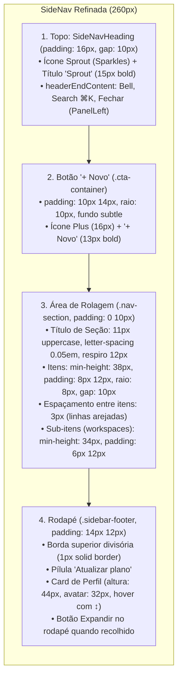

# 🎨 Walkthrough: Alinhamento Estrutural e Densidade da SideNav (Sprout UI)

> **Autor:** Sally (UX Designer & UI Specialist — BMad Method)  
> **Iniciativa:** `initiative-sprout-ui`  
> **Referência:** `file:///home/mraraujo/workspace/ft_bpo_shell/docs/demo/bpo_workspace_shell_prototype.html`  
> **Status:** Implementado e Verificado com Sucesso  

---

## 1. Visão Geral das Alterações

Refinamos a **aparência, densidade, espaçamentos e ritmo visual** da barra lateral (`SideNav`) da Sprout UI, baseando-nos rigorosamente nas medidas e proporções do protótipo [`bpo_workspace_shell_prototype.html`](file:///home/mraraujo/workspace/ft_bpo_shell/docs/demo/bpo_workspace_shell_prototype.html) e mantendo **100% inalterados o tema Y2K Dark e os tokens do Astryx**:



---

## 2. Detalhamento Técnico das Implementações

### 2.1. Densidade e Espaçamento de Itens (`.nav-item` do Protótipo)
- **Altura e Área de Toque**: Itens de menu (`.astryx-side-nav-item`) agora contam com **`min-height: 38px`** e **`padding: 8px 12px`**, proporcionando uma área de clique confortável e ergonômica.
- **Cantos Arredondados e Gap**: Borda arredondada suave de **`8px`** e espaçamento vertical entre linhas de **`3px`**, eliminando a sensação de densidade compactada ou itens colados.
- **Ícones e Tipografia**: Gap de **`10px`** entre ícone (16×16px, stroke 1.75) e o rótulo de texto (13px, peso 500 no repouso e 600 quando ativo).

### 2.2. Botão de Ação "+ Novo" (`.btn-new-chat` do Protótipo)
- Substituído o botão genérico pelo componente refinado `.sprout-btn-new`:
  - Envolvido em `.sprout-sidebar-cta` com padding `0 12px 12px 12px`.
  - Padding interno de **`10px 14px`**, cantos arredondados de **`10px`**.
  - Fundo sutil translúcido (`var(--color-background-muted)`), borda de 1px (`var(--color-border)`) e texto 13px peso 600 com ícone `Plus`.
  - Efeito suave ao passar o mouse (`background-color: var(--color-background-card)`, borda enfatizada).

### 2.3. Hierarquia das Seções (`.section-title` do Protótipo)
- Títulos de seção com caixa alta, tamanho de fonte de **`11px`**, **`letter-spacing: 0.05em`** e peso **`700`**.
- Respiro vertical superior de **`12px`** antes de cada seção (*Agentes Abertos*, *Projetos*, *Recentes*), criando uma cadência visual limpa e escaneável.

### 2.4. Cabeçalho e Rodapé Delimitados
- **Cabeçalho**: Padding de `14px 14px 12px 14px` e altura mínima de 52px.
- **Rodapé**: Wrapper `.sprout-sidebar-footer` com padding de `14px 12px 12px 12px`, delimitado por borda superior divisória sutil de 1px (`border-top: 1px solid var(--color-border)`).

---

## 3. Resultados dos Testes e Validação Técnica

### 3.1. Testes Automatizados (`bun test`)
```text
bun test v1.4.3 (c6da4a4d3)

app/features/plant/routes/plant.test.tsx:
✓ PlantScreen (componentes do Astryx) > começa com o formulário e o estado vazio do agente [119.33ms]
✓ PlantScreen (componentes do Astryx) > planta: mostra a spec enviada e o log do plantio [213.53ms]
✓ PlantScreen (componentes do Astryx) > destino ocupado: volta ao formulário com o erro e o texto preservado [157.00ms]
✓ PlantScreen (componentes do Astryx) > não envia vazio e mostra o motivo [52.98ms]
✓ PlantScreen (componentes do Astryx) > renderiza a SideNav no padrão Perplexity com + Novo, Agentes Abertos, Projetos e Usuário [36.77ms]
✓ PlantScreen (componentes do Astryx) > selecionar um agente aberto na sidebar abre seu terminal e permite voltar ao Composer [78.56ms]
✓ PlantScreen (componentes do Astryx) > clicar em + Novo restaura a visão do Composer [203.22ms]
✓ PlantScreen (componentes do Astryx) > envia o plantio com Ctrl+Enter dentro do markdown [184.19ms]
✓ PlantScreen (componentes do Astryx) > botão Plantar outro restaura o Zero-State Composer [162.84ms]
✓ PlantScreen (componentes do Astryx) > rodapé da SideNav: clica no perfil e abre o Popover conforme Print 3 [37.98ms]
✓ PlantScreen (componentes do Astryx) > topo da SideNav: possui botões de Notificações, Busca e botão de fechar menu no cabeçalho (padrão finops) [30.39ms]
✓ PlantScreen (componentes do Astryx) > clicar no botão de fechar/recolher menu no topo alterna o estado e exibe botão de expandir no rodapé [211.78ms]
✓ PlantScreen (componentes do Astryx) > renderiza rodapé institucional com Termos de Serviço e Aviso de Privacidade no composer [18.46ms]

app/features/plant/api/mock-api.test.ts: (8 testes passando)
app/features/plant/lib/use-plant-form.test.tsx: (5 testes passando)
app/features/plant/lib/suggest.test.ts: (10 testes passando)

 36 pass
 0 fail
 75 expect() calls
Ran 36 tests across 4 files. [1.78s]
```

### 3.2. Checagem de Tipos TypeScript (`bun run typecheck`)
```bash
cd ui && bun run typecheck
$ react-router typegen && tsc --noEmit
# 0 erros
```

### 3.3. Compilação de Produção (`bun run build`)
```bash
cd ui && bun run build
$ react-router build
✓ built in 3.76s (SPA Mode: Generated build/client/index.html)
```

---

## 4. Conclusão
A barra lateral da Sprout UI agora reflete a densidade, conforto ergonômico, espaçamento e proporções do protótipo BPO Shell, oferecendo navegação agradável, visual de software maduro e total estabilidade técnica.
