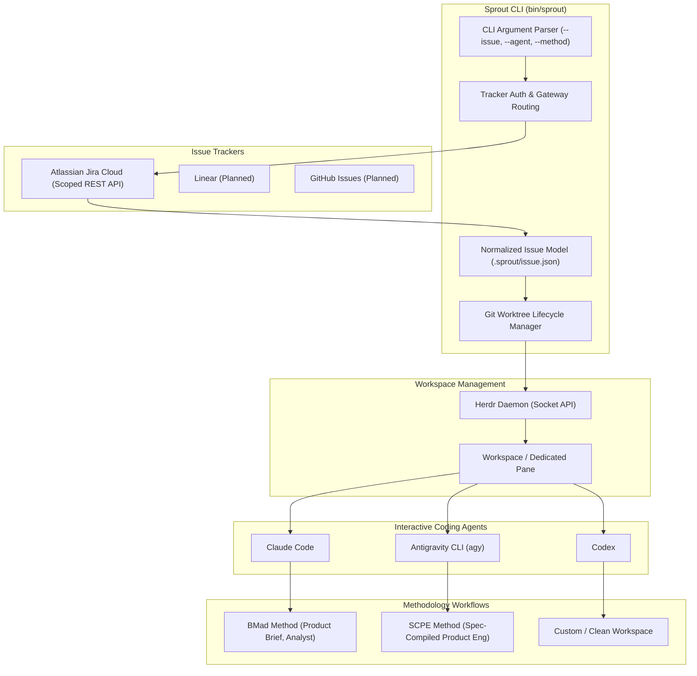

# Sprout Architecture

**Sprout** is a developer-agent automation tool designed to bridge task tracking (Jira, Linear, GitHub Issues), Git version control (Worktrees), terminal workspace management (Herdr), and agentic workflows (BMad, SCPE, etc.).

## System Overview



## Configuration & Secrets Layer

Sprout follows a strict **zero-secrets-in-repo** philosophy and uses Git's internal metadata to share project configuration across worktrees, split into two levels:

```text
┌────────────────────────────────────────────────────────────────────────┐
│ 1. User Secrets (~/.sprout/auth.toml) — chmod 600                      │
│    Stores global Jira/tracker credentials outside all Git trees        │
└────────────────────────────────────────────────────────────────────────┘
                                    │
┌───────────────────────────────────┼────────────────────────────────────┐
│ Canonical Base Repo               │ Linked Worktree (e.g. ../FT-123)   │
│ .git/sprout/config.toml           │ .git (file pointing to common dir) │
│ 2. Project Settings & Defaults    │ Automatically shares config.toml   │
└───────────────────────────────────┴────────────────────────────────────┘
```

| Config File | Location | Permissions | Purpose |
| :--- | :--- | :--- | :--- |
| **User Secrets** | `~/.sprout/auth.toml` | `600` (dir `700`) | Personal API credentials (Jira site URL, email, scoped API token). Kept in your home directory, never committed. |
| **Project Settings** | `<git-common-dir>/sprout/config.toml` | `600` | Project metadata (`name`, `github_repo`) and default selections (`agent`, `method`). Shared by all worktrees. |

### Why `sprout init` Must Run in the Canonical Base Repo

1. 🔗 **Automatic sharing across worktrees:** Git worktrees share a central internal metadata store (`--git-common-dir`). Saving `config.toml` inside this shared Git directory means every worktree spawned by Sprout automatically inherits the project configuration, without duplicating files or writing to the source tree.
2. 🛡️ **Zero Git pollution & no leaks:** Because the file lives inside Git's internal administrative metadata (outside the tracked files), it never appears in `git status`, cannot be accidentally staged or committed, and requires zero `.gitignore` modifications.
3. 📍 **No hardcoded absolute paths:** Sprout dynamically discovers the canonical base repository and its common directory at runtime via Git metadata. Even if you move or rename sibling directories, Sprout resolves paths accurately.

## Architectural Layers

### 1. Tracker & Auth Layer
- Communicates with Jira Cloud using Atlassian API Gateway (`https://api.atlassian.com/ex/jira/<cloudId>`) and scoped tokens.
- Discovers the tenant Cloud ID via `/_edge/tenant_info`.
- Resolves issue details (`summary`, `description`, `issuetype`, `status`, `priority`, `assignee`).
- Converts all ticket data into the tracker-neutral `.sprout/` contract below, so other providers (Linear, GitHub Issues) can plug in without changing downstream consumers.
- Decouples credentials (`~/.sprout/auth.toml`, chmod 600) from source repositories (with backward compatibility fallback to `~/.jdw/auth.toml`).

### 2. Git Worktree Layer
- Auto-detects the canonical repository even when executed from an existing worktree (via `--git-common-dir`).
- Enforces Conventional Commit branch naming conventions (`feat/<slug>`, `fix/<slug>`).
- Defaults the branch slug to the issue key, lowercased with hyphens converted to underscores (e.g. `fix/ft_123`); pass `--slug` for a custom, descriptive slug instead.
- Configures upstream tracking against `origin/main`.

### 3. Normalized Issue Model (`.sprout/`)
- Every worktree created via `sprout` contains a local `.sprout/` directory:
  - `issue.json`: Machine-readable, normalized issue payload (key, summary, description plain-text, raw ADF fields, status, priority, web link).
  - `issue.md`: Human- and LLM-friendly markdown brief.
- This creates an immutable contract between tracker and any downstream agent/methodology.

### 4. Workspace & Multi-Agent Orchestration (Herdr)
- Uses `herdr workspace create --cwd "$target" --label "$label" --focus` to spin up a terminal workspace.
- Detects the newly initialized terminal pane ID (`root_pane.pane_id`).
- Dispatches the requested agent (`herdr agent start <name> --kind <agent> --pane <id>`).
- Dispatches the initial prompt without blocking the developer's interactive session (`herdr agent prompt <name> <text>`).

### 5. Methodology Decoupling
- `sprout` does **not** hardcode a single methodology.
- Supports pluggable workflow templates:
  - `bmad`: Invokes the BMad master orchestrator to parse the issue and draft the initial product briefing.
  - `scpe`: Prompts the agent to begin vertical slicing and specification according to SCPE.
  - `none`: Leaves the agent in an interactive state without pre-submitting a prompt.

### 6. Smart Agent Router & Task-Type Model Tiering
- **Smart Agent Router:** Evaluates provider cooldown timers (`agents_status.json`) and queries live Herdr concurrency to route to the least saturated agent.
- **Task-Type Model Tiering:** Maps Conventional Commit types (`feat`, `fix`, `docs`, `chore`, etc.) to calibrated model tiers (`frontier`, `balanced`, `fast`) and propagates appropriate model parameters to `claude`, `agy`, or `codex`.

### 7. Session Lifecycle & Context Compaction (`sprout session recycle`)
- Solves **Context Rot** by snapshotting state to `.sprout/handoff.md` (uncommitted diffs, status, recent commits, and task description).
- Cleanly restarts the bloated agent process inside the existing Herdr pane, restoring full attention and reducing token usage back to baseline (~3k tokens).

### 8. Zero-Git Greenfield Creation (`sprout new`) & Local-First Worktrees
- **Zero-Git Pre-requisites:** Projects can be bootstrapped from scratch without an existing Git repo or remote GitHub account using `sprout new <name>`.
- **Local-First Fallback:** Worktree commands (`sprout feat`, `sprout fix`, `sprout sync`, `sprout prune`) do not require a remote `origin/main`. If an `origin` remote has not been configured yet, Sprout cleanly uses the local `main` branch as the base reference without throwing errors.
- **Optional Jira Integration:** Repositories initialized via `sprout init` treat Jira credentials as strictly optional, enabling free-form prompt and document-driven workflows without requiring Atlassian accounts.

### 9. Transactional Safety & Autonomous Rollback Engine
- **Atomic Operations:** Task worktree creation (`sprout feat`, `fix`) and project initialization (`sprout new`, `plant`) execute within a transactional boundary.
- **Autonomous Rollback on Interruption:** If an operation is aborted (`SIGINT` / Ctrl+C), terminated, or encounters an execution failure before completion:
  - Any allocated Herdr workspace is cleanly closed.
  - The Git worktree reference is detached and pruned (`git worktree remove --force` + `git worktree prune`).
  - The created working directory is removed.
  - The unmerged Git branch is deleted (`git branch -D`).
  - Temporary authentication/API files are cleaned up.
- **Zero-Conflict Guarantee:** Retrying a command immediately after an abort never encounters `Destination already exists` or `Branch already exists` errors.

