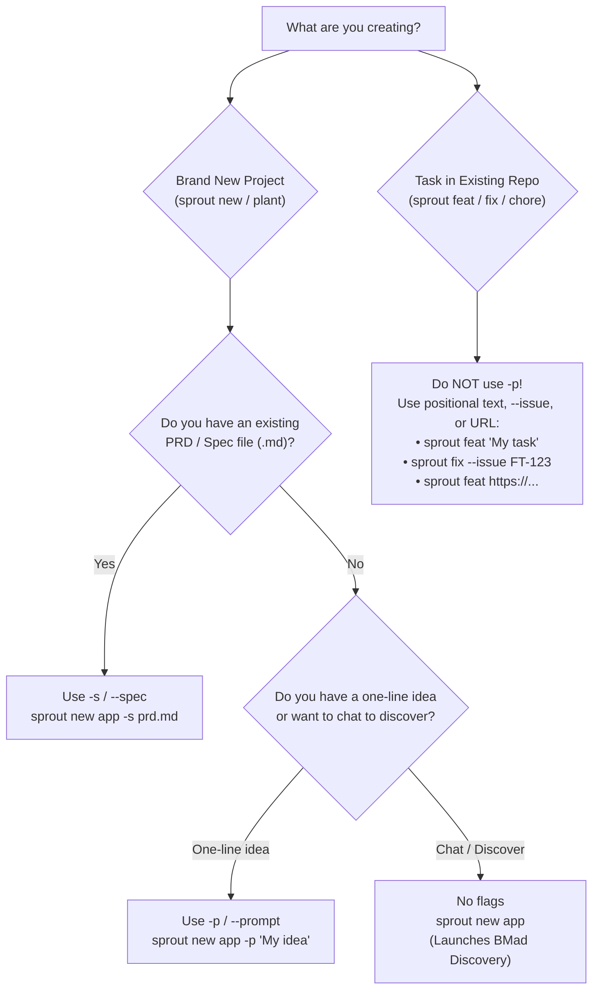

# Sprout Creation & Ingestion Guide

Sprout provides multiple deterministic, transactional ways to create **brand new projects**, **plant existing codebases**, and spawn **isolated task worktrees**.

This guide covers:
1. [Understanding `-p` (`--prompt`): When to Use and When NOT to Use](#1-understanding--p---prompt-when-to-use-and-when-not-to-use)
2. [Project Creation: `sprout new` vs `sprout plant`](#2-project-creation-sprout-new-vs-sprout-plant)
3. [Task & Worktree Creation: `sprout feat`, `fix`, `chore`, etc.](#3-task--worktree-creation-sprout-feat-fix-chore-etc)
4. [Review Worktrees: `sprout review`](#4-review-worktrees-sprout-review)
5. [Specialized Ingestion Modes (Stdin, Articles, Files, Jira)](#5-specialized-ingestion-modes-stdin-articles-files-jira)
6. [Advanced Overrides & Fine-Tuning](#6-advanced-overrides--fine-tuning)
7. [Decision Matrix: Which Creation Method Should I Use?](#7-decision-matrix-which-creation-method-should-i-use)

---

## 1. Understanding `-p` (`--prompt`): When to Use and When NOT to Use

The `-p` / `--prompt <TEXT>` flag is specifically designed for **project initialization and planting** (`sprout new` and `sprout plant`). It provides an inline vision or product description that Sprout writes into `.sprout/spec.md`.



### ✅ When to USE `-p`
* **Inline project idea:** When creating a greenfield project with `sprout new` and you want to prime the agent with a short vision without creating a separate markdown file beforehand:
  ```bash
  sprout new task_manager -p "Dashboard de tarefas em Next.js com autenticação e Prisma"
  ```
* **Inline plant:** When planting a repository structure with a quick brief:
  ```bash
  sprout plant ~/workspace/finances -p "Sistema de conciliação bancária via OFX"
  ```
* **Stdin pipe (`-p -`):** When piping an idea or AI prompt output into `sprout new`:
  ```bash
  cat ideia.txt | sprout new meu_app -p -
  ```

### ❌ When NOT to USE `-p`
* **When you already have a PRD / Spec document:** Use **`-s` / `--spec`** instead. It preserves document hierarchy, diagrams, and tables into `.sprout/spec.md`:
  ```bash
  sprout new meu_app -s specs/prd.md
  # or remote markdown/HTML:
  sprout new meu_app -s https://raw.githubusercontent.com/org/repo/main/spec.md
  ```
* **When you want interactive requirements discovery:** Omit `-p` and `-s` entirely. Sprout launches the BMad Discovery flow (`bmad-brainstorming` / `bmad-product-brief`) to interview you:
  ```bash
  sprout new meu_app
  ```
* **In daily task worktrees (`sprout feat`, `fix`, etc.):** The `-p` flag **does not exist** on task creation commands. For worktrees in existing repos, pass text positionally or use `-c` / `--issue` / `--link`.
* **When doing headless setup without an agent:** Use `--no-agent`:
  ```bash
  sprout new meu_app --no-agent
  ```

---

## 2. Project Creation: `sprout new` vs `sprout plant`

Sprout offers two commands to bootstrap projects:

### A. `sprout new <NAME>` (Zero Git Pre-requisites)
Designed for starting completely new repositories on your machine. Sprout creates the directory, runs `git init`, establishes a clean `main` branch, sets up `.sprout/config.toml`, commits initial project files, and opens the Herdr workspace.

```bash
# 1. Discovery / Greenfield mode (agent starts in BMad Discovery):
sprout new billing_service

# 2. Inline idea / prompt:
sprout new billing_service -p "Microsserviço de cobrança com Stripe e Webhooks"

# 3. Document-driven (Markdown / HTML / URL):
sprout new billing_service -s specs/billing_v1.md

# 4. Custom branch name:
sprout new billing_service -b develop -p "API de notificações"

# 5. Headless scaffolding (zero AI tokens):
sprout new billing_service --no-agent
```

### B. `sprout plant [SOURCE] [DEST]` (Clone, Seed, or Scaffold)
Designed for cloning remote repositories or converting existing specifications into active projects:

```bash
# 1. Clone remote Git repository and initialize Sprout:
sprout plant git@github.com:my-org/finance_tool.git
sprout plant https://github.com/my-org/finance_tool.git --branch develop

# 2. Plant from a specification document directly (infers project name):
sprout plant vision.md
sprout plant specs/prd.html ~/workspace/meu_app

# 3. Combine a remote repository clone with a new specification document:
sprout plant git@github.com:my-org/core.git --spec specs/v2.md

# 4. Plant an empty directory:
sprout plant ~/workspace/novo_projeto
```

---

## 3. Task & Worktree Creation: `sprout feat`, `fix`, `chore`, etc.

When working inside or alongside an existing repository, you create isolated Git worktrees using Conventional Commit task types:
`feat`, `fix`, `docs`, `refactor`, `perf`, `test`, `build`, `ci`, `chore`, `revert`.

### Mode 1: Positional Free-Form Text
The most natural and fastest way to sprout a task. Sprout automatically derives the branch slug and evaluates semantic complexity:
```bash
sprout feat "Adicionar exportação CSV no relatório de vendas"
# -> Creates branch: feat/adicionar_exportacao_csv
# -> Evaluates complexity and chooses appropriate model tier (Opus / Gemini-Argon)
```

### Mode 2: Jira Cloud Integration (`--issue`)
Pulls summary, description, and acceptance criteria from Jira, generating `.sprout/issue.json` and `.sprout/issue.md`:
```bash
sprout fix --issue FT-123
# -> Branch: fix/FT-123 (or issue-derived slug)
# -> Pre-loads ticket description into agent plan mode
```

### Mode 3: Web Links & Articles (`[URL]` or `--link`)
Sprout fetches remote documentation or architectural articles, strips boilerplate, and structures the task:
```bash
# Positional URL:
sprout feat https://eng.uber.com/circuit-breaking-architecture/

# Title with explicit link:
sprout feat "Implementar Circuit Breaker" --link https://martinfowler.com/articles/.../circuit-breaker.html
```

### Mode 4: Context Flag (`-c` / `--context`) & File (`--context-file`)
```bash
# Inline context:
sprout feat -c "Refatorar camada de autenticação para JWT stateless"

# Context from local file:
sprout feat --context-file specs/auth.md

# Context from remote URL via flag:
sprout fix --context-file https://raw.githubusercontent.com/org/repo/main/docs/cache-bug.md
```

---

## 4. Review Worktrees: `sprout review`

Reviewing pull requests should never pollute your working tree. `sprout review` creates or resumes a dedicated, isolated review worktree:

```bash
# 1. Review a PR by number or GitHub URL:
sprout review 42
sprout review https://github.com/my-org/repo/pull/42

# 2. Inside an active worktree: refresh review comments in-place:
sprout review

# 3. Clean context before triage:
sprout review 42 --recycle
```

**What it does:**
1. Checks out a dedicated worktree `review/pr-<number>`.
2. Downloads PR commits (`git fetch origin pull/<number>/head`).
3. Fetches PR discussion comments and inline code review annotations (`gh api`).
4. Generates `.sprout/review.md` and `.sprout/review.json`.
5. Starts the agent in plan mode:
   - If comments exist: triggers **BMad Review Triage** (Must Fix, Optional, Out of Scope).
   - If 0 comments exist: triggers an architectural diff audit against `origin/main`.
6. Once finished, `sprout prune` cleanly removes the worktree and the review branch.

---

## 5. Specialized Ingestion Modes (Stdin, Articles, Files, Jira)

### Stdin Ingestion (`-` or `-c -`)
You can pipe outputs from git, test runners, or other tools directly into Sprout:

```bash
# Pipe git diff as context for a bug fix:
git diff | sprout fix "Corrigir regressão nos testes unitários" -c -

# Pipe failing logs:
tail -n 50 /var/log/app.log | sprout fix "Investigar timeout no gateway" -c -

# Pipe an idea into a new project:
curl -sL https://example.com/spec.txt | sprout new pipeline_service -p -
```

### Non-Interactive & Scripted Creation
If you are automating Sprout inside CI/CD or shell scripts:
* `--no-prompt`: Suppresses interactive questions.
* `-y, --yes`: Auto-confirms teardown/prune operations.
* `--no-agent`: Creates worktree and configuration without spawning an agent.
* `--no-herdr`: Creates pure local Git worktrees without registering in Herdr.

---

## 6. Advanced Overrides & Fine-Tuning

Sprout allows overriding any auto-derived metadata:

| Override Flag | Description | Example |
| :--- | :--- | :--- |
| `--feature <NAME>` | Overrides directory name under `~/workspace` | `sprout feat FT-123 --feature auth_refactor` |
| `--slug <SLUG>` | Overrides the branch name | `sprout fix FT-123 --slug fix_null_pointer` |
| `--branch <BRANCH>`| Base branch or review branch override | `sprout review 42 --branch audit/pr-42` |
| `--dest <PATH>` | Explicit destination directory | `sprout new app --dest /opt/projects/app` |
| `-a, --agent <NAME>`| Agent runtime override (`auto`, `claude`, `agy`, `codex`) | `sprout feat "Task" -a claude` |
| `--model <MODEL>` | Model override (`opus`, `gemini-4-argon`, etc.) | `sprout feat "Task" --model opus` |
| `--effort <LEVEL>` | Reasoning effort (`high`, `medium`, `low`) | `sprout feat "Task" --effort high` |
| `-m, --method <M>` | Methodology prompt (`bmad`, `scpe`, `none`) | `sprout feat "Task" -m scpe` |

---

## 7. Decision Matrix: Which Creation Method Should I Use?

| What I have | My Goal | Command to Run |
| :--- | :--- | :--- |
| **Nothing (just a project name)** | Brainstorm requirements with AI from scratch | `sprout new meu_app` |
| **A project idea in my head** | Start a greenfield project with initial context | `sprout new meu_app -p "Descrição..."` |
| **A PRD file on disk (`.md`/`.html`)** | Bootstrap project from formal specification | `sprout new meu_app -s specs/prd.md` |
| **A remote Git repository** | Clone, configure Sprout, and open workspace | `sprout plant git@github.com:org/repo.git` |
| **An existing repo + new spec** | Clone repo and seed it with a new PRD | `sprout plant git@... --spec specs/v2.md` |
| **A feature idea in existing repo** | Create task worktree & branch from idea | `sprout feat "Descrição da funcionalidade"` |
| **A Jira ticket key (`FT-123`)** | Create task worktree with Jira context | `sprout fix --issue FT-123` |
| **A web article / doc link** | Create worktree directly from documentation | `sprout feat https://eng.uber.com/...` |
| **A Pull Request (`#42`)** | Review PR in isolated worktree with comments | `sprout review 42` |
| **A pipe of error logs / diff** | Pass live diagnostics to the agent | `cat erro.log \| sprout fix "Bug" -c -` |
| **Just the Git repo scaffold** | Create clean project without starting agent | `sprout new meu_app --no-agent` |
